# Информационная система «Потеряшки». Этапы 1–2

Отчёт по первому этапу курсовой работы: анализ предметной области и проектирование системы.

## Задание

Первый этап курсовой работы включает:

1. Выбор предметной области информационной системы.
2. Подробное текстовое описание предметной области.
3. Обоснование назначения системы и решаемых задач.
4. Формулирование функциональных и нефункциональных требований.
5. Построение моделей основных прецедентов и описание их сценариев.
6. Выбор архитектуры, технологий и фреймворков с учётом демонстрации на helios.
7. Подготовку отчёта.

## 1. Предметная область

Предметная область — поиск и возврат потерянных вещей в городской среде. Разрабатываемая информационная система «Потеряшки» предназначена для публикации объявлений о потерянных и найденных предметах с указанием места и времени события, поиска совпадений, проверки заявителей и фиксации возврата. Дополнительно предусматриваются справочная интеграция с Петербургским метрополитеном, доступ к пользовательским функциям по подписке и аукционы вещей, которыми продавец вправе распоряжаться.

В качестве начального региона выбран Санкт-Петербург. Приложение проектируется как адаптивное веб-приложение. Подписка предоставляет доступ к пользовательским операциям после верификации учётной записи. Регистрация, оплата, восстановление доступа и официальные инструкции доступны до активации подписки. Цена задаётся администратором; конкретная стоимость не является требованием этапа 1. Базовый расчётный период подписки — 30 суток без автоматического списания.

Для демонстрации оплаты используется тестовый платёжный адаптер. Проверка пользователя включает подтверждение электронной почты и рассмотрение профиля модератором. Паспортные данные при регистрации не запрашиваются. После безуспешного поиска владельца пользователь может подать заявку на аукцион; возможность продажи зависит от основания распоряжения вещью и решения по заявке.

## 2. Подробное описание предметной области

### 2.1. Участники и их интересы

Владелец потерянной вещи стремится быстро найти предмет и подтвердить своё право на его получение. Нашедший стремится сообщить о находке, передать её надлежащему получателю и избежать многократных необоснованных обращений. Один пользователь может выступать в обеих ролях в разных ситуациях. Покупатель участвует в аукционе; продавцом становится пользователь, право распоряжения вещью которого проверено.

Постоянные роли доступа — участник, модератор и администратор. Нашедший, владелец, продавец и покупатель обозначают положение участника в конкретном процессе. Модератор проверяет учётные записи, объявления, жалобы и документы для допуска аукционов. Администратор управляет полномочиями сотрудников, тарифами, справочником организаций и аудитом. Физическое хранение и выдачу вещей могут осуществлять пользователи либо сторонние организации: метрополитен, городское бюро находок, полиция. Эти организации не считаются зарегистрированными партнёрами без отдельной договорённости.

Платёжный сервис подтверждает результаты оплаты подписки. Пользователь обращается к нему через платёжную форму. Почтовый сервис доставляет ссылки подтверждения и восстановления доступа. В самой системе уведомления сохраняются независимо от успешности доставки письма.

### 2.2. Существующий процесс и проблемы

Сведения о находках обычно распределены между объявлениями в социальных сетях, локальными чатами, бюро находок и транспортными организациями. Объявления оформляются неодинаково: часто отсутствуют время, точное место, категория или актуальный статус. Потерявшему приходится повторять поиск на нескольких площадках и связываться с авторами уже неактуальных сообщений.

Нашедший не всегда знает порядок передачи вещи и нужную организацию. Публикация полной фотографии документов или всех отличительных признаков увеличивает вероятность злоупотреблений. Несколько претендентов могут одновременно заявить права на один предмет. Отсутствие истории решений затрудняет разбор споров, а свободная публикация без проверки повышает долю рекламы, ложных находок и повторяющихся сообщений.

Подписка повышает стоимость массового злоупотребления и поддерживает работу сервиса, но сама по себе не гарантирует добросовестность. Поэтому в проекте она дополняется верификацией профиля, предварительной модерацией, ограничением частоты действий и механизмом жалоб. Сроки подписки и судьба уже опубликованной находки управляются раздельно.

### 2.3. Процесс работы с потерянными и найденными вещами

Пользователь регистрируется, подтверждает почту, проходит проверку профиля и активирует подписку. Затем он создаёт объявление типа «Потерял» или «Нашёл». Для находки фиксируются предмет, категория, описание, место, дата и время обнаружения, текущее место хранения. Для потери допускается временной интервал и приблизительный район, поскольку точный момент может быть неизвестен.

Часть признаков является публичной: категория, цвет, общее описание, район, дата, безопасная фотография. Контрольные признаки — например, содержимое сумки или индивидуальная отметка — видны только автору и уполномоченному модератору. Контактные сведения и точный адрес хранения не публикуются в общем каталоге.

Объявление проходит модерацию. После публикации пользователи ищут предметы по типу объявления, категории, месту и времени. Поиск возвращает опубликованные карточки, соответствующие заданным условиям. Сходство описания не считается доказательством принадлежности: пользователь направляет заявку и описывает скрытые признаки. Автор находки рассматривает заявку, может запросить уточнения и согласовать передачу через внутренний диалог.

После согласования система резервирует находку за одним претендентом. Фактическая передача происходит вне приложения, затем обе стороны подтверждают её. До второго подтверждения вещь имеет статус «Передача ожидает подтверждения»; при споре дело передаётся модератору. Если предмет хранится у организации, система показывает её порядок выдачи; самостоятельное подтверждение в приложении не заменяет решения организации.

### 2.4. Находки в метрополитене

Для места типа «Метро» указываются город, станция и при наличии линия или участок поездки. В карточке показываются официальные инструкции: справочная Петербургского метрополитена 8-800-350-11-55; вещи передаются дежурному по станции и находятся в метро 10 дней, затем передаются в городской Центр утерянных документов и средств связи по адресу: ул. Большая Монетная, д. 16, офис-центр № 1. Для получения вещи требуется паспорт и заявление. Эти сведения взяты с официальной страницы метрополитена [1].

Найденную в метро вещь пользователь передаёт сотруднику станции и может опубликовать информационное объявление с указанием организации хранения. Приложение предлагает уточнить актуальные условия по официальному контакту. Десятидневный срок не используется как срок допуска к аукциону. Данные справочника содержат ссылку на источник, дату проверки и дату следующего пересмотра; администратор проверяет их не реже одного раза в 30 дней.

Интеграция с метрополитеном реализуется через справочник организаций: приложение подбирает контакты и инструкцию по выбранному месту. Пользователь обращается в организацию по указанному телефону или через официальный сайт. Прямой обмен сведениями о находках может быть добавлен при наличии доступного программного интерфейса и договорённости с метрополитеном.

### 2.5. Условия аукциона

Обычная находка не становится товаром только потому, что на объявление долго нет откликов. Статья 227 ГК РФ предусматривает уведомление известного владельца; находку в помещении или транспорте передают представителю владельца помещения или транспорта. Когда надлежащий получатель неизвестен, предусмотрено заявление в полицию либо орган местного самоуправления [3]. Публикация в «Потеряшках» не заменяет такого заявления.

Для обычной находки статья 228 ГК РФ связывает приобретение собственности с отсутствием установленного или заявившегося правообладателя в течение шести месяцев после заявления о находке в компетентный орган. При отказе нашедшего приобрести вещь она поступает в муниципальную собственность [4]. Поэтому проект использует дату официального заявления и проверку подтверждающих материалов, а не дату публикации объявления.

Продавец подаёт заявку на допуск вещи к аукциону, указывает основание распоряжения и прикладывает подтверждение обращения и права. Модератор проверяет комплектность, отсутствие открытого спора и принадлежность допустимой категории; сомнительное основание ведёт к отказу. Автоматически подтверждается только комплектность данных, решение о допуске принимает модератор. Вещи, переданные метро или иной организации, обычный пользователь на аукцион не выставляет.

Из аукционного каталога исключаются документы, банковские карты, предметы с персональными данными, опасные и запрещённые предметы, а также вещи с неразрешёнными заявлениями владельцев. Для электронных устройств требуется подтверждение законного распоряжения и удаления пользовательских данных. Частные случаи продажи скоропортящихся вещей не включены в учебный процесс.

Аукцион проводится на повышение: задаются стартовая цена, шаг и время начала и окончания. Продавец не может делать ставки на собственный лот. Победителем становится автор наибольшей принятой ставки до срока окончания. Отсутствие ставок означает завершение без победителя. Расчёты за лот и доставку стороны организуют самостоятельно; система фиксирует договорённость и подтверждение передачи.

### 2.6. Основные информационные объекты

| Объект | Основные сведения | Назначение |
| --- | --- | --- |
| Пользователь | ID, имя, email, хеш пароля, набор ролей, статус проверки и блокировки, версия токенов | Учёт участника и управление доступом |
| Токен обновления | Пользователь, хеш токена, срок действия, отметка отзыва | Обновление доступа и завершение авторизации |
| Верификация | Пользователь, дата подачи, решение, причина, модератор | История рассмотрения профиля |
| Подписка | Пользователь, начало и окончание, статус, оплаченный тариф | Проверка права доступа |
| Платёж | ID операции, сумма, статус, внешний идентификатор | Связь оплаты с подпиской |
| Объявление | Тип, автор, категория, описание, время, место, статус | Учёт потери или находки |
| Фотография | Объявление, ключ файла, MIME, размер, доступность | Безопасная иллюстрация предмета |
| Контрольный признак | Объявление, закрытое описание | Проверка претендента |
| Место | Город, тип, район/адрес, станция, координаты при наличии | Поиск и подбор организации |
| Организация | Название, контакты, инструкция, URL источника, даты проверки | Справочная интеграция |
| Заявка на возврат | Находка, претендент, доказательства, статус | Рассмотрение права на получение |
| Диалог и сообщение | Участники, заявка, текст, время | Согласование возврата |
| Передача | Находка или лот, стороны, подтверждения, дата | Завершение жизненного цикла |
| Жалоба | Автор, объект, причина, решение | Контроль качества и спорные ситуации |
| Допуск к аукциону | Находка, основание, документы, решение | Контроль возможности продажи |
| Аукцион и ставка | Лот, продавец, цены, сроки, участник, серверное время | Организация торгов |
| Уведомление и аудит | Получатель/исполнитель, событие, время, результат | Информирование и прослеживаемость |

Это концептуальный состав данных. Логическая и физическая схемы PostgreSQL разрабатываются на следующем этапе.

### 2.7. Статусы и бизнес-правила

Объявление проходит состояния «Черновик → На модерации → Опубликовано». Из модерации возможны «Отклонено» или «На исправлении»; изменённое объявление проходит повторную проверку. Опубликованная находка может перейти в «Зарезервировано → Передача ожидает подтверждения → Возвращено». Отмена согласования возвращает её в опубликованное состояние. Автор может закрыть поиск; модератор — скрыть нарушающее правила объявление. Закрытая находка сохраняется в истории и не участвует в выдаче активных результатов.

У аукциона состояния «Черновик → На проверке → Допущен → Запланирован → Активен → Завершён с победителем / Завершён без ставок». Дополнительно предусмотрены «Отказано», «Приостановлен», «Отменён», «Передан покупателю». Неурегулированная претензия блокирует запуск и новые ставки; модератор определяет дальнейшее решение, оно сохраняется в аудите.

- BR-01. Публикация, поиск каталога, заявки, сообщения и ставки доступны проверенному, незаблокированному пользователю с активной подпиской. Сотрудники работают по служебным ролям без платной подписки.
- BR-02. До подписки разрешены регистрация, подтверждение почты, проверка профиля, покупка или продление подписки, восстановление доступа, просмотр собственных статусов и официальных контактов.
- BR-03. После истечения подписки новые пользовательские операции закрываются; ранее опубликованные объявления остаются видимыми. Участник может прочитать существующий диалог, подтвердить уже согласованную передачу, закрыть своё объявление и направить жалобу по своему делу без продления.
- BR-04. Проверка профиля не подтверждает принадлежность конкретной вещи. Каждая заявка на возврат рассматривается отдельно. Оплата не отменяет модерацию.
- BR-05. Для находки обязательны место и дата/время. Для потери допускается интервал; его начало не позже конца. Время события не может находиться в будущем. Ввод и отображение выполняются в часовом поясе Санкт-Петербурга Europe/Moscow; хранение и сравнение — как момент времени UTC.
- BR-06. Для метро обязательна станция либо описание участка поездки. Приложение не обещает наличие вещи в реестре организации.
- BR-07. У находки может быть несколько заявок, но не более одного действующего резервирования. Автор не направляет заявку на собственную находку.
- BR-08. Возврат закрывается после двух подтверждений или мотивированного решения модератора. Скрытые признаки и материалы спора не входят в публичный каталог.
- BR-09. Продление оплаченной подписки добавляет 30 суток от более позднего значения: текущего момента или окончания действующей подписки. Повторное платёжное событие не добавляет срок повторно.
- BR-10. Блокировка запрещает действия независимо от подписки. Принятые до истечения подписки ставки сохраняются; блокировка участника активного аукциона приостанавливает его до решения модератора.
- BR-11. Аукцион возможен только после отдельного допуска. Отсчёт шести месяцев по обычной находке ведётся от официального заявления; истечение срока лишь позволяет подать заявку на проверку и не создаёт допуск автоматически.
- BR-12. Ставка принимается при активном аукционе и серверном времени строго раньше окончания. Минимальная ставка — стартовая цена при отсутствии ставок, иначе последняя принятая цена плюс шаг. Денежные суммы хранятся точно, без float.
- BR-13. Одновременные ставки обрабатываются последовательно в транзакции для одного лота. При одинаковом предложении принимается только первая допустимая ставка; второй запрос получает актуальную минимальную цену.
- BR-14. Результат поиска помогает выбрать карточку для проверки. Принадлежность вещи подтверждается отдельно; поиск не заменяет рассмотрения примет и оснований распоряжения.
- BR-15. Одна находка не может одновременно участвовать в возврате и продаже. После допуска и планирования аукциона обычное резервирование блокируется, а новые заявления владельцев поступают модератору и приостанавливают торги. На одну находку допускается только один незавершённый аукцион. Возврат возможен после отмены продажи и рассмотрения заявления.

## 3. Назначение системы и решаемые задачи

Цель системы — создать единое управляемое пространство поиска и возврата вещей, в котором сведения структурированы, участники проверены, а действия прослеживаются. Система должна сокращать количество площадок, которые просматривает пользователь, и помогать выбирать правильный маршрут обращения.

Система решает следующие задачи:

1. Собирать объявления о потерях и находках в едином каталоге со стандартными полями места, времени и предмета.
2. Давать поиск и подбор потенциально связанных объявлений без раскрытия контрольных признаков.
3. Обеспечивать доступ по подписке, проверку профилей, модерацию публикаций и рассмотрение жалоб.
4. Сопровождать заявку на возврат, общение сторон, резервирование и подтверждение фактической передачи.
5. Показывать проверенные контакты и порядок действий для находок в метрополитене.
6. Поддерживать контролируемый аукцион вещей с подтверждённым основанием распоряжения.
7. Сохранять историю изменений, платежей, ставок и решений для разрешения спорных ситуаций.

Результативность системы оценивается по числу подтверждённых возвратов, времени от публикации до первого обоснованного отклика, доле отклонённых нарушающих правила объявлений и сроку обработки модерации. Технические критерии приёмки определены в разделе 4.

## 4. Требования к информационной системе

Требования относятся к учебной версии, реализованной на Java и PostgreSQL. Каждая карточка описывает одну функцию или одно свойство системы. Статус отражает состояние реализации; трудоёмкость указана как качественная оценка сложности разработки.

### 4.1. Функциональные требования

#### FR-01. Учётная запись

| Поле | Значение |
| --- | --- |
| ID | FR-01 |
| Название | Учётная запись |
| Описание | Система должна позволять пользователю зарегистрироваться по электронной почте и паролю, подтвердить адрес, войти в свою учётную запись и восстановить пароль по одноразовой ссылке. |
| Приоритет | Критический |
| Источник | Участник |
| Статус | Реализовано |
| Трудоёмкость | Средняя: формы доступа и обработка одноразовых ссылок. |
| Стабильность | Высокая |

#### FR-02. Проверка профиля

| Поле | Значение |
| --- | --- |
| ID | FR-02 |
| Название | Проверка профиля |
| Описание | Система должна предоставлять модератору профиль пользователя с подтверждённой почтой для проверки. Модератор должен иметь возможность одобрить профиль или отклонить его с указанием причины. |
| Приоритет | Критический |
| Источник | Модератор, участник |
| Статус | Реализовано |
| Трудоёмкость | Низкая: очередь профилей и форма решения. |
| Стабильность | Высокая |

#### FR-03. Подписка

| Поле | Значение |
| --- | --- |
| ID | FR-03 |
| Название | Подписка |
| Описание | Система должна предоставлять проверенному участнику доступ к каталогу и новым пользовательским операциям на оплаченный срок подписки. Покупка и продление в учебной версии должны выполняться через демонстрационную оплату без списания реальных денег. |
| Приоритет | Критический |
| Источник | Участник |
| Статус | Реализовано в учебном режиме |
| Трудоёмкость | Средняя: заказ, срок подписки и проверка доступа. |
| Стабильность | Высокая |

#### FR-04. Публикация объявления

| Поле | Значение |
| --- | --- |
| ID | FR-04 |
| Название | Публикация объявления |
| Описание | Система должна позволять участнику подготовить объявление о потере или находке с описанием предмета, категорией, местом и временем события. Участник может приложить фотографии JPEG/PNG и закрытые приметы. Объявление должно появляться в каталоге после одобрения модератором. |
| Приоритет | Критический |
| Источник | Участник, модератор |
| Статус | Реализовано |
| Трудоёмкость | Средняя: редактор объявления, фотографии и модерация. |
| Стабильность | Высокая |

#### FR-05. Поиск вещей

| Поле | Значение |
| --- | --- |
| ID | FR-05 |
| Название | Поиск вещей |
| Описание | Система должна предоставлять поиск опубликованных объявлений по тексту, типу, категории, месту и периоду события. Результаты должны выводиться страницами не более чем по 20 карточек с переходом к описанию выбранной вещи. |
| Приоритет | Критический |
| Источник | Участник |
| Статус | Реализовано |
| Трудоёмкость | Средняя: фильтры каталога и запросы PostgreSQL. |
| Стабильность | Высокая |

#### FR-06. Возврат вещи

| Поле | Значение |
| --- | --- |
| ID | FR-06 |
| Название | Возврат вещи |
| Описание | Система должна сопровождать возврат от заявки предполагаемого владельца до подтверждённой передачи. Для этого стороны должны иметь возможность обсудить приметы в закрытом диалоге, согласовать одного получателя и отдельно подтвердить выдачу и получение вещи. |
| Приоритет | Критический |
| Источник | Участники — нашедший и предполагаемый владелец |
| Статус | Реализовано |
| Трудоёмкость | Высокая: заявка, диалог, резервирование и передача. |
| Стабильность | Высокая |

#### FR-07. Справочник метрополитена

| Поле | Значение |
| --- | --- |
| ID | FR-07 |
| Название | Справочник метрополитена |
| Описание | Система должна показывать контакты Петербургского метрополитена и порядок обращения за потерянными вещами без обязательной подписки. Запись должна содержать официальный источник и дату проверки; администратор должен иметь возможность её обновить. |
| Приоритет | Высокий |
| Источник | Участник, администратор |
| Статус | Реализовано как справочная интеграция |
| Трудоёмкость | Низкая: справочник организаций и страница инструкции. |
| Стабильность | Средняя: контакты и порядок выдачи могут изменяться. |

#### FR-08. Рассмотрение спора

| Поле | Значение |
| --- | --- |
| ID | FR-08 |
| Название | Рассмотрение спора |
| Описание | Система должна позволять участнику направить жалобу по находке и видеть её состояние. Независимый модератор должен иметь возможность изучить материалы дела и сохранить мотивированное решение. |
| Приоритет | Высокий |
| Источник | Участник, модератор |
| Статус | Реализовано |
| Трудоёмкость | Средняя: жалоба, доступ к материалам и решение. |
| Стабильность | Высокая |

#### FR-09. Аукцион

| Поле | Значение |
| --- | --- |
| ID | FR-09 |
| Название | Аукцион |
| Описание | Система должна проводить аукцион вещи после проверки основания распоряжения модератором: принимать ставки участников до окончания торгов, определять победителя по наибольшей принятой ставке и создавать дело передачи победителю. |
| Приоритет | Высокий |
| Источник | Участники — продавец и покупатели, модератор |
| Статус | Реализовано; расчёт за лот выполняется вне приложения |
| Трудоёмкость | Высокая: допуск, ставки, завершение и передача. |
| Стабильность | Высокая |

#### FR-10. Уведомления

| Поле | Значение |
| --- | --- |
| ID | FR-10 |
| Название | Уведомления |
| Описание | Система должна сохранять в кабинете участника уведомления о событиях его дел: решении по профилю или объявлению, новом сообщении, результате жалобы, истечении подписки и завершении аукциона. |
| Приоритет | Высокий |
| Источник | Участник |
| Статус | Реализовано |
| Трудоёмкость | Средняя: события, доставка в кабинет и отметка прочтения. |
| Стабильность | Высокая |

### 4.2. Нефункциональные требования

Нефункциональные требования определяют условия использования, защиты данных и запуска учебной версии. Для общей учебной машины не задаются гарантии круглосуточной доступности, обслуживания тысяч пользователей или времени восстановления после сбоя сервера.

#### NFR-01. Удобство интерфейса

| Поле | Значение |
| --- | --- |
| ID | NFR-01 |
| Название | Удобство интерфейса |
| Описание | Система должна предоставлять русскоязычный веб-интерфейс с подписями полей и сообщениями об ошибках ввода. Основные формы должны быть пригодны для работы на телефоне и компьютере; для демонстрации используется Microsoft Edge. |
| Приоритет | Высокий |
| Источник | Участник, модератор, администратор |
| Статус | Реализовано |
| Трудоёмкость | Средняя: шаблоны страниц и адаптивные стили. |
| Стабильность | Высокая |

#### NFR-02. Конфиденциальность данных

| Поле | Значение |
| --- | --- |
| ID | NFR-02 |
| Название | Конфиденциальность данных |
| Описание | Система должна проверять права на сервере перед выдачей закрытых примет, диалогов и документов. Такие материалы должны быть доступны сторонам соответствующего дела и уполномоченному сотруднику при рассмотрении дела. |
| Приоритет | Критический |
| Источник | Участник, модератор |
| Статус | Реализовано |
| Трудоёмкость | Средняя: проверки ролей и принадлежности материалов. |
| Стабильность | Высокая |

#### NFR-03. Защита паролей

| Поле | Значение |
| --- | --- |
| ID | NFR-03 |
| Название | Защита паролей |
| Описание | Система должна хранить пароли пользователей только в виде хешей BCrypt. Исходный пароль не должен попадать в ответы страниц и журнал приложения. |
| Приоритет | Критический |
| Источник | Участник, администратор |
| Статус | Реализовано |
| Трудоёмкость | Низкая: использование кодировщика Spring Security. |
| Стабильность | Высокая |

#### NFR-04. Транзакционная целостность

| Поле | Значение |
| --- | --- |
| ID | NFR-04 |
| Название | Транзакционная целостность |
| Описание | Система должна сохранять взаимосвязанные изменения одной операции в транзакции PostgreSQL. Параллельные запросы должны сохранять ограничения предметной области, в том числе единственность действующего резервирования одной находки. |
| Приоритет | Критический |
| Источник | Участник, модератор |
| Статус | Реализовано |
| Трудоёмкость | Высокая: функции PL/pgSQL, ограничения и блокировки. |
| Стабильность | Высокая |

#### NFR-05. Повторная обработка запросов

| Поле | Значение |
| --- | --- |
| ID | NFR-05 |
| Название | Повторная обработка запросов |
| Описание | Система должна безопасно обрабатывать повтор одного и того же события оплаты, ставки с тем же ключом и подтверждения передачи. Повтор не должен создавать вторую подписку, дублирующую ставку или повторно завершать передачу. |
| Приоритет | Высокий |
| Источник | Участник |
| Статус | Реализовано |
| Трудоёмкость | Средняя: уникальные ключи и проверки состояния. |
| Стабильность | Высокая |

#### NFR-06. Размещение на helios

| Поле | Значение |
| --- | --- |
| ID | NFR-06 |
| Название | Размещение на helios |
| Описание | Система должна запускаться на helios из JAR в одной JVM Java 17 с ограничением heap до 256 МиБ. Данные должны храниться в выделенных объектах PostgreSQL, вложения — в каталоге курсовой. Доступ к веб-интерфейсу должен выполняться через SSH-туннель к локальному порту приложения. |
| Приоритет | Критический |
| Источник | Условия выполнения курсовой работы |
| Статус | Реализовано в конфигурации учебного запуска |
| Трудоёмкость | Средняя: сборка JAR и настройка окружения. |
| Стабильность | Высокая |

### 4.3. Границы реализации

В учебной версии используются демонстрационная оплата подписки и почтовый кабинет с одноразовыми ссылками. Внешняя отправка писем предусмотрена через настраиваемый SMTP-адаптер. Контакты метро сохраняются в справочнике и обновляются администратором; обмен внутренними реестрами метрополитена не требуется. Денежные расчёты за аукционный лот и физическая передача вещи происходят вне приложения. Автоматическое распознавание предметов, рекомендации совпадений, доставка и нативное мобильное приложение в требования не входят.

## 5. Основные прецеденты

### 5.1. Участники процессов

В системе сохраняются три роли доступа: участник, модератор и администратор. Нашедший, предполагаемый владелец, продавец и покупатель — положения участника в конкретном процессе, а не отдельные роли учётной записи. В сценариях возврата и продажи действуют разные пользователи с одной ролью «Участник».

Модератор проверяет профили и объявления, рассматривает споры и основания продажи. Администратор управляет служебными полномочиями, тарифами и справочником организаций; он также может выполнять работу модератора. Эти настройки обеспечивают описанные процессы и не выделяются в отдельные прецеденты.

Ниже описаны пять законченных процессов. Для каждого указаны сюжет, участники, условия начала, основной и альтернативные потоки и результат. На каждой диаграмме один прецедент имеет идентификатор UC; связанные с ним действия раскрывают его состав. Связь «include» обозначает обязательную часть процесса, «extend» — действие при указанном условии. Диаграммы не задают порядок шагов; порядок приведён в основном потоке.

### 5.2. UC-01. Получить доступ к сервису

Новый пользователь потерял рюкзак и хочет искать его в каталоге. Перед началом поиска он создаёт учётную запись, подтверждает почту, проходит проверку модератора и оформляет подписку. В процессе участвуют пользователь и модератор; результатом становится оплаченный доступ проверенного участника.

| Поле | Описание |
| --- | --- |
| ID | UC-01 |
| Цель | Получить доступ к каталогу и пользовательским операциям. |
| Главный актёр | Участник, впервые обращающийся к сервису. |
| Другой актёр | Модератор. |
| Предусловия | Регистрация доступна; есть действующий тариф; модератор имеет служебный доступ. |
| Триггер | Пользователь выбирает регистрацию для начала поиска вещи. |
| Постусловия | Почта подтверждена, профиль одобрен, подписка активна; участник может открыть каталог. |
| Требования | FR-01–03, FR-10; NFR-01, NFR-03, NFR-05. |

Основной поток:

1. Пользователь открывает форму регистрации и вводит имя, почту и пароль.
2. Система проверяет поля и уникальность адреса, создаёт учётную запись и ссылку подтверждения.
3. Пользователь получает ссылку через учебный почтовый кабинет и открывает её. При настроенном SMTP ссылка доставляется письмом.
4. Система проверяет одноразовую ссылку и отмечает подтверждение адреса.
5. Пользователь отправляет профиль на проверку. Система помещает его в очередь модератора.
6. Модератор открывает профиль, проверяет представленные сведения и одобряет доступ с указанием причины решения.
7. Система сохраняет решение и показывает его пользователю в кабинете.
8. Пользователь выбирает тариф и создаёт заказ на подписку. Система фиксирует цену и длительность в заказе.
9. Пользователь подтверждает демонстрационную оплату. Учебный адаптер передаёт успешный результат без списания денег.
10. Система учитывает оплату и активирует оплаченный период.
11. Участник открывает каталог. Система проверяет состояние профиля и подписки и показывает объявления.

Альтернативные потоки:

- A1, шаг 2. Адрес уже используется: система предлагает вход. При утрате пароля пользователь запрашивает ссылку восстановления, задаёт новый пароль и входит.
- A2, шаг 4. Ссылка просрочена или использована: подтверждение не выполняется; пользователь запрашивает новую ссылку и повторяет шаги 3–4.
- A3, шаг 6. Профиль отклонён: пользователь получает причину, исправляет сведения и повторно подаёт профиль. Каталог остаётся закрытым.
- A4, шаг 9. Оплата отменена или завершилась отказом: заказ сохраняет результат, подписка не активируется. Пользователь может создать новый заказ.
- A5, шаги 8–10. Проверенный участник продлевает доступ: оплаченный период добавляется к действующему сроку либо начинается с текущего момента, если прежний срок истёк. Повтор результата того же заказа не продлевает доступ второй раз.

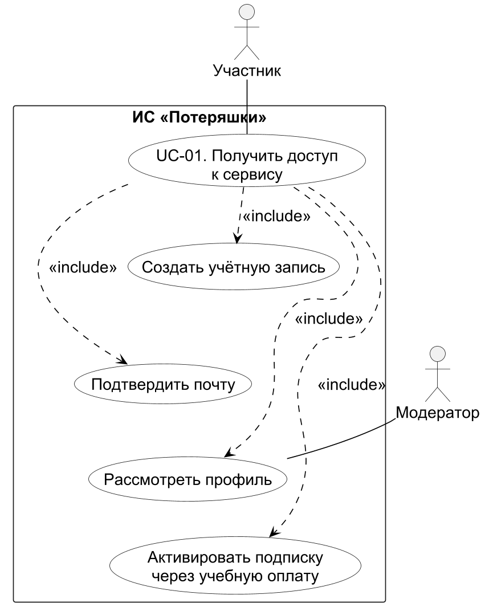

### 5.3. UC-02. Опубликовать находку

Участник нашёл зонт в городском парке. Он создаёт карточку с местом и временем находки, прикладывает фотографию и оставляет надпись на внутренней стороне ручки закрытой приметой. Модератор проверяет объявление перед публикацией. После одобрения другие участники могут найти карточку в каталоге.

| Поле | Описание |
| --- | --- |
| ID | UC-02 |
| Цель | Опубликовать сведения о находке для поиска владельца. |
| Главный актёр | Участник — нашедший вещь. |
| Другой актёр | Модератор. |
| Предусловия | Автор вошёл в систему, профиль одобрен, подписка активна; категория и место доступны в справочниках. |
| Триггер | Нашедший выбирает создание объявления «Нашёл». |
| Постусловия | Проверенная карточка опубликована; закрытая примета сохраняется отдельно от публичного описания. |
| Требования | FR-04, FR-10; NFR-01, NFR-02, NFR-04. |

Основной поток:

1. Нашедший открывает редактор и выбирает тип «Нашёл».
2. Он указывает название предмета, категорию, место, дату и время находки и описание.
3. Система проверяет обязательные поля и сохраняет черновик, связанный с автором.
4. Автор прикладывает фотографию зонта. Система проверяет JPEG/PNG и размер файла до 5 МБ и сохраняет изображение.
5. Автор записывает надпись на ручке как закрытую примету. Система не добавляет её в публичное описание.
6. Автор отправляет черновик на модерацию. Система меняет состояние объявления и помещает его в очередь.
7. Модератор просматривает описание и фотографии, проверяет соответствие правилам и отсутствие открытых персональных данных.
8. Модератор одобряет публикацию. Система фиксирует автора решения и время проверки.
9. Система открывает карточку для поиска в каталоге и сохраняет уведомление автору.
10. Нашедший проверяет опубликованную карточку и ожидает заявок владельцев.

Альтернативные потоки:

- A1, шаги 2–3. Место, категория или время не указаны либо время находится в будущем: система показывает ошибку и сохраняет возможность исправить ввод.
- A2, шаг 4. Формат или размер фотографии не подходит: файл отклоняется, черновик остаётся доступным; автор заменяет фотографию или публикует карточку без неё.
- A3, шаг 8. Модератор отклоняет карточку: автор видит состояние объявления, исправляет описание или фотографию и повторяет отправку. Непроверенная версия в каталог не попадает.
- A4, шаг 2. Вещь найдена в метро и передана сотруднику станции: автор указывает организацию хранения. В карточке показываются её контакты; личная заявка на получение у автора не создаётся.
- A5, шаг 1. Автор сообщает о собственной потере: выбирает «Потерял», указывает предполагаемое место и допустимый интервал времени. Подготовка и модерация выполняются тем же порядком.

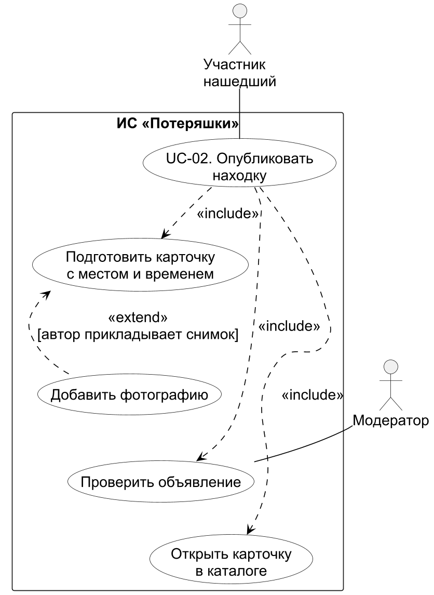

### 5.4. UC-03. Вернуть вещь владельцу

Другой участник потерял зонт и находит опубликованную карточку. Он сообщает нашедшему надпись на ручке, которую нельзя увидеть в каталоге. После проверки приметы стороны договариваются о встрече и отдельно подтверждают передачу. В этом процессе участвуют две разные учётные записи.

| Поле | Описание |
| --- | --- |
| ID | UC-03 |
| Цель | Передать найденную вещь подтверждённому владельцу и завершить поиск. |
| Главные актёры | Два участника — предполагаемый владелец и нашедший. |
| Предусловия | Оба участника вошли в систему; находка опубликована и хранится у автора; при создании заявки у владельца действует подписка; другого резерва и незавершённого аукциона нет. |
| Триггер | Предполагаемый владелец открывает карточку подходящей находки. |
| Постусловия | Выдача и получение подтверждены сторонами; дело завершено, находка отмечена возвращённой. |
| Требования | FR-05–07, FR-10; NFR-02, NFR-04, NFR-05. |

Основной поток:

1. Владелец задаёт текст «зонт», категорию, место и примерный период потери.
2. Система показывает подходящие опубликованные карточки. Владелец открывает найденное объявление.
3. Владелец направляет заявку и описывает цвет, обстоятельства потери и закрытую надпись на ручке.
4. Система проверяет возможность заявки, сохраняет доказательства и создаёт закрытый диалог сторон.
5. Нашедший открывает заявку и сравнивает сведения с предметом и своей закрытой приметой.
6. Нашедший запрашивает уточнение в диалоге. Владелец отвечает, не публикуя личные контакты в каталоге.
7. Нашедший принимает заявку и согласовывает возврат.
8. Система резервирует находку за этим получателем и создаёт одно дело передачи.
9. Стороны договариваются о месте и времени встречи через диалог.
10. При встрече нашедший физически передаёт зонт и отмечает выдачу в своём кабинете.
11. Система сохраняет первое подтверждение; дело остаётся открытым до ответа другой стороны.
12. Владелец проверяет вещь и отдельно подтверждает получение.
13. Система завершает передачу, меняет состояние находки на «Возвращено» и сохраняет уведомления.

Альтернативные потоки:

- A1, шаг 2. Подходящих карточек нет: владелец изменяет фильтры или публикует объявление о потере по UC-02. Процесс возврата пока не начинается.
- A2, шаг 3. Находка хранится у метрополитена: система показывает официальный контакт, источник и инструкцию. Пользователь обращается в организацию вне приложения; личная заявка и резерв у автора не создаются.
- A3, шаги 5–7. Приметы не совпадают: нашедший отклоняет заявку. Она сохраняется в истории, а вещь остаётся доступной другим претендентам.
- A4, шаг 8. Другую заявку успели принять раньше: система отклоняет второй резерв. У одной находки остаётся один действующий получатель.
- A5, шаг 9. Встреча отменена до подтверждений: владелец отменяет согласованную заявку, система освобождает находку. После первого подтверждения обычная отмена недоступна; участник обращается к модератору по UC-04.
- A6, шаги 10–12. Подписка истекла после согласования: стороны могут прочитать существующий диалог и подтвердить уже начатую передачу без покупки новой подписки.
- A7, шаг 12. Возник спор о выдаче или принадлежности: дело не считается завершённым, участник направляет жалобу по UC-04.

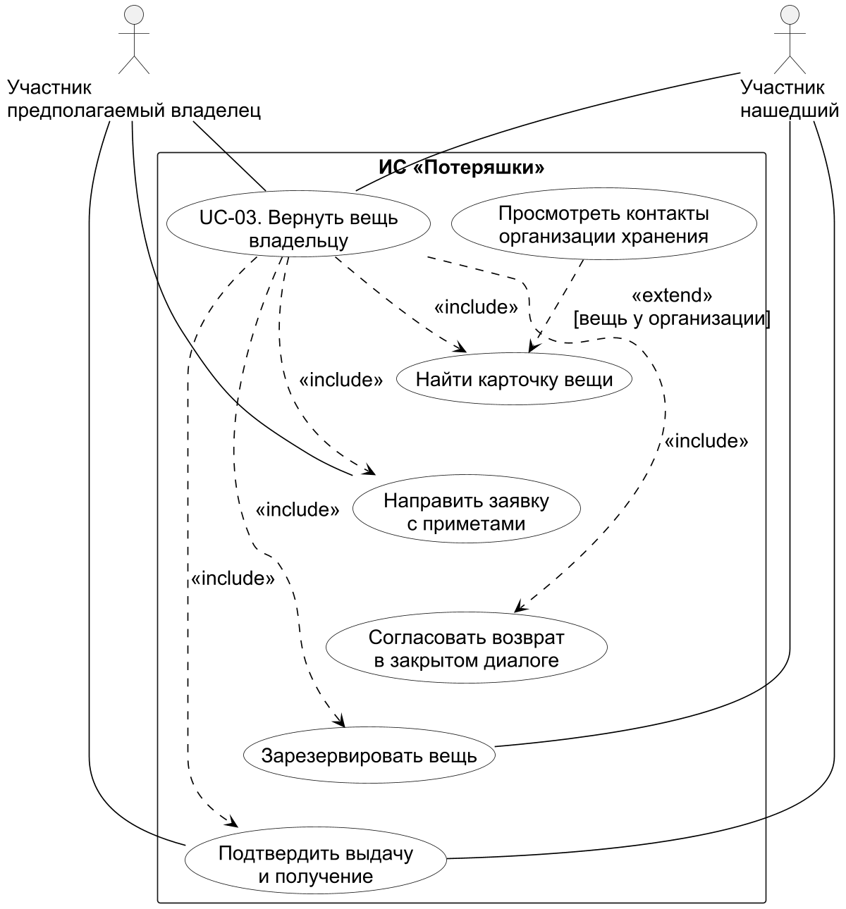

### 5.5. UC-04. Разрешить спор о находке

Нашедший отметил выдачу зонта, но предполагаемый владелец утверждает, что получил другую вещь, и не подтверждает получение. Обычная отмена уже недоступна. Участник направляет жалобу, независимый модератор изучает доказательства и переписку, получает пояснения сторон и принимает решение.

| Поле | Описание |
| --- | --- |
| ID | UC-04 |
| Цель | Разобрать конфликт по находке и сохранить решение по делу. |
| Главный актёр | Участник — заявитель жалобы. |
| Другие актёры | Другой участник дела; независимый модератор. |
| Предусловия | Существует объявление и связанное дело; заявитель вошёл в систему и участвует в деле; модератор не является автором спорного объявления или стороной жалобы. |
| Триггер | Участник подаёт жалобу с описанием противоречия. |
| Постусловия | Жалоба рассмотрена с указанием причины решения; при подтверждённой выдаче спорная передача завершена служебным решением. |
| Требования | FR-06, FR-08, FR-10; NFR-02, NFR-04. |

Основной поток:

1. Заявитель открывает своё дело и направляет жалобу на объявление, описывая спор и обстоятельства встречи.
2. Система проверяет право обращения, сохраняет жалобу и показывает статус «Ожидает рассмотрения».
3. Независимый модератор открывает жалобу в служебной очереди.
4. Система предоставляет связанные заявки, признаки предмета и диалоги только на время рассмотрения открытой жалобы.
5. Модератор сопоставляет описание находки, доказательства владельца, сообщения и имеющееся подтверждение выдачи.
6. Модератор задаёт уточняющий вопрос в диалоге. Заявитель и нашедший отвечают со своих учётных записей.
7. После проверки выясняется, что передан тот же зонт, а заявитель неверно понял состояние предмета. Модератор формулирует причину решения о подтверждённой выдаче.
8. Модератор завершает спорную передачу служебным решением. Система сохраняет исполнителя и причину изменения состояния.
9. Модератор сохраняет решение по жалобе. Система закрывает её и уведомляет заявителя.
10. Заявитель читает результат в кабинете; другая сторона видит завершённое состояние передачи. Доступ сотрудника к закрытому диалогу по этой жалобе прекращается.

Альтернативные потоки:

- A1, шаг 3. Модератор связан с жалобой: система не позволяет ему принять решение; дело рассматривает другой сотрудник с полномочиями модератора.
- A2, шаги 5–7. Подтверждений фактической передачи недостаточно: модератор фиксирует решение по жалобе без завершения передачи. Находка не получает статус «Возвращено»; завершение возможно после подтверждений сторон или обоснованного служебного решения.
- A3, шаг 7. Выявлено нарушение: модератор сохраняет решение об обоснованной жалобе и при необходимости блокирует нарушителя с указанием причины. Состояние передачи изменяется только отдельным допустимым действием.
- A4, шаг 1. Подписка заявителя истекла: обращение по собственному ранее созданному делу остаётся доступным.
- A5, шаг 9. Жалобу уже рассмотрел другой модератор: второе решение не записывается, сотрудник видит текущее состояние.

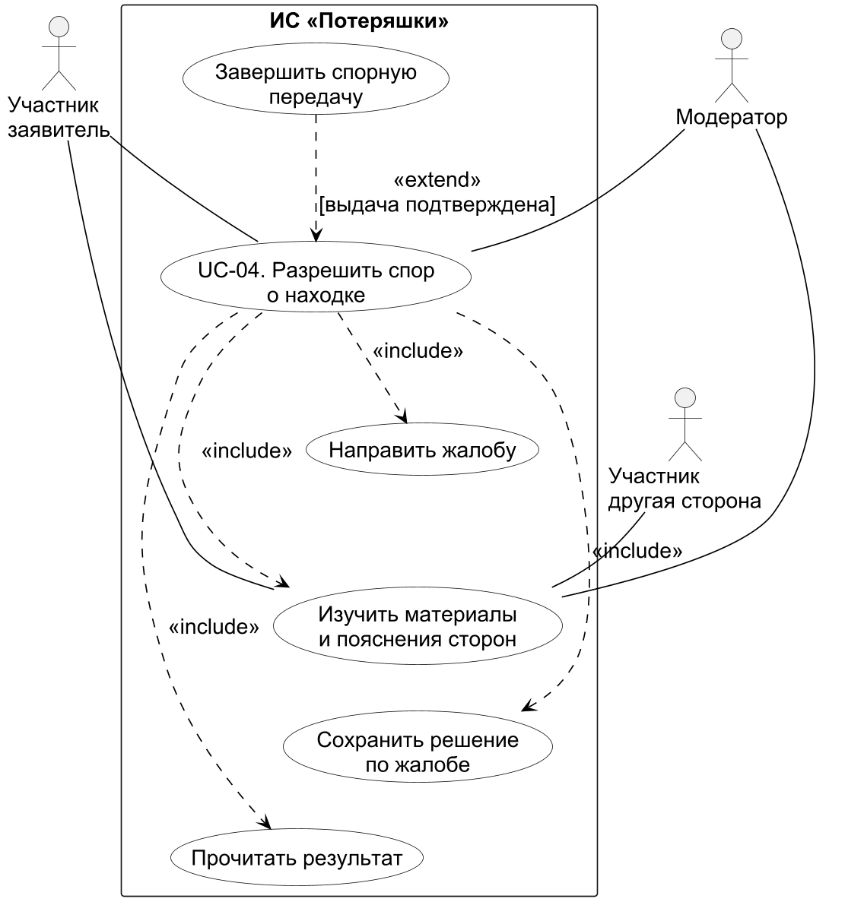

### 5.6. UC-05. Продать вещь на аукционе

Владелец другой находки не установлен. После выполнения предусмотренного порядка заявления и приобретения права распоряжения участник подаёт материалы на проверку. Модератор допускает продажу, два покупателя соревнуются ставками, а победитель согласовывает получение с продавцом. Давность объявления сама по себе не разрешает продажу.

| Поле | Описание |
| --- | --- |
| ID | UC-05 |
| Цель | Провести разрешённые торги и передать вещь победителю. |
| Главный актёр | Участник — продавец, имеющий основание распоряжения вещью. |
| Другие актёры | Участники — покупатели; независимый модератор. |
| Предусловия | Продавец проверен и имеет подписку; вещь хранится у него, относится к разрешённой категории и не зарезервирована для возврата; есть материалы основания распоряжения; открытого спора нет. |
| Триггер | Продавец подаёт заявку на допуск вещи к аукциону. |
| Постусловия | Победитель определён по принятой ставке; выдача и получение подтверждены продавцом и покупателем; история торгов сохранена. |
| Требования | FR-06, FR-09, FR-10; NFR-02, NFR-04, NFR-05. |

Основной поток:

1. Продавец открывает свою находку и указывает основание распоряжения, дату официального заявления и подтверждающий документ.
2. Система проверяет обязательные сведения и сохраняет заявку на допуск.
3. Модератор изучает материалы и проверяет отсутствие запрета по категории, действующего возврата и открытого спора.
4. Модератор одобряет допуск с указанием причины. Система сохраняет решение.
5. Продавец создаёт лот, задаёт стартовую цену, шаг, начало и окончание торгов.
6. Система проверяет условия лота и сохраняет запланированный аукцион. Приём ставок возможен только в указанное время.
7. Первый покупатель открывает лот и направляет ставку.
8. Система проверяет доступ покупателя, время и сумму, сохраняет принятую ставку.
9. Другой покупатель предлагает большую сумму. Система последовательно проверяет и принимает подходящие предложения; продавец в своих торгах не участвует.
10. По окончании срока обработчик завершения определяет победителя по наибольшей принятой ставке.
11. Система сохраняет итог и создаёт одно дело передачи между продавцом и победителем с закрытым диалогом.
12. Продавец и победитель договариваются о встрече и расчёте вне приложения.
13. Продавец передаёт вещь и подтверждает выдачу; победитель подтверждает получение.
14. Система завершает передачу и сохраняет историю лота, ставок и подтверждений.

Альтернативные потоки:

- A1, шаги 2–4. Основание не подтверждено, категория запрещена или есть спор: допуск отклоняется; лот не создаётся. Продавец видит причину и может исправить комплект материалов.
- A2, шаг 8. Предложение поступило вне срока, не достигает допустимой суммы или отправлено продавцом: ставка отклоняется, текущая цена не меняется.
- A3, шаг 9. Две ставки пришли одновременно: PostgreSQL обрабатывает их с блокировкой аукциона и повторно проверяет цену. Каждая принятая ставка соответствует актуальному шагу.
- A4, шаг 10. Ставок нет: аукцион завершается без победителя и без дела передачи.
- A5, шаги 6–9. На лот поступила претензия владельца: модератор рассматривает жалобу по UC-04 и при подтверждении основания отменяет незавершённые торги. Отменённый аукцион не принимает ставки; прежние предложения сохраняются в истории.
- A6, шаги 8 или 10. Запрос ставки с тем же ключом либо завершение торгов повторены: система возвращает сохранённый результат, не создаёт дубликат ставки или второе дело передачи.
- A7, шаг 13. После первого подтверждения стороны спорят о выдаче: передача остаётся открытой и разбирается по UC-04.

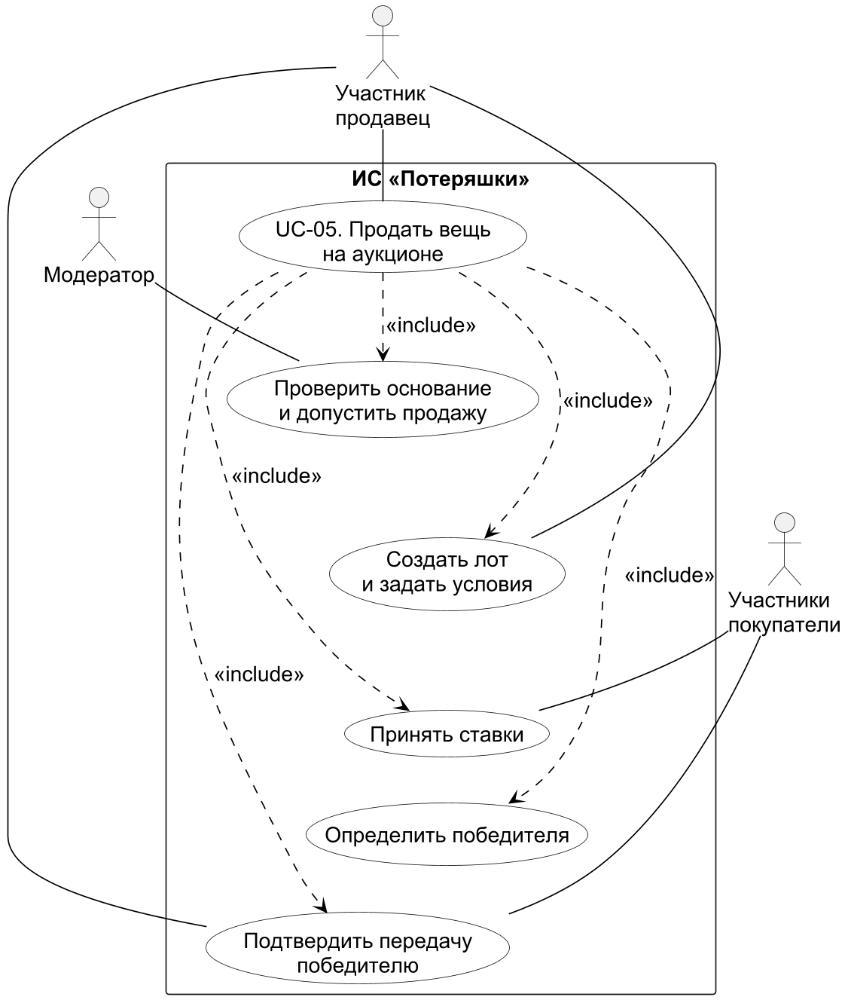


## 6. Предлагаемая архитектура

### 6.1. Архитектурный подход и технологии

Система проектируется как модульное монолитное приложение на Java 17. Одна JVM принимает HTTP-запросы, формирует страницы и выполняет прикладные операции. PostgreSQL и файловое хранилище отделены от процесса приложения. Модули предметной области разделяют ответственность, но используют общие правила доступа и транзакции.

| Уровень | Технологии | Ответственность |
| --- | --- | --- |
| Веб-сервер | Apache Tomcat, встроенный в Spring Boot | Приём HTTP-запросов и передача в цепочку фильтров и Spring MVC |
| Представление | Spring MVC, Thymeleaf, HTML, CSS | Страницы, формы, валидация параметров, отображение результатов и ошибок |
| Аутентификация | Spring Security, JWT, BCrypt | Проверка сеанса, защита форм CSRF, вход, выход и обновление токенов |
| Бизнес-логика | Java-сервисы, AccessPolicy, Spring Transactions | Правила процессов, права на объекты, координация действий и транзакционные границы |
| Хранение | Hibernate/JPA, Spring Data JPA, JdbcTemplate | Проекции сущностей, параметризованные запросы, вызовы функций и процедур |
| База данных | PostgreSQL, PL/pgSQL | Связи, ограничения, триггеры, блокировки и критичные переходы состояний |
| Файловый адаптер | Закрытый локальный каталог, Java ImageIO | Проверка фотографий, хранение вложений и выдача после проверки прав |
| Внешние адаптеры | Учебная оплата; почтовый интерфейс и SMTP | Подтверждение оплаты подписки, отправка писем и замена интеграций для демонстрации |
| Сборка и проверка | Gradle Wrapper, JUnit, Spring Test, Java-модуль tooling | Сборка JAR, интеграционные проверки, диаграммы, отчёты и установка на helios |

Java, Spring Boot, Hibernate/JPA, PostgreSQL, Lombok и Gradle выбраны с учётом проекта MyFilmList [7]. Spring MVC и Thymeleaf позволяют включить контроллеры и представления в один JAR [8, 9]. Семейство Spring Boot 3.5 поддерживает выбранную версию Java [5]. Версии фиксируются в build.gradle. Изменения схемы представлены SQL-скриптами в Git; Hibernate проверяет соответствие сущностей существующей схеме и не создаёт таблицы при запуске.

Схема раскрывает устройство приложения «Потеряшки» внутри Spring Boot: встроенный Tomcat, фильтры Spring Security, MVC-контроллеры, HTML-шаблоны Thymeleaf, предметные сервисы, планировщик, репозитории и адаптеры. Узлы обозначают веб-сервер, компоненты — программные модули, артефакт — шаблоны, цилиндр — PostgreSQL, папка — закрытые вложения. Контроллеры вызывают сервисы и формируют модели страниц; сервисы используют JPA-репозитории и SQL-доступ через JdbcTemplate. PostgreSQL и настраиваемый SMTP-сервер показаны вне приложения. Приложение размещается на helios; браузер подключается по HTTP через SSH-туннель.

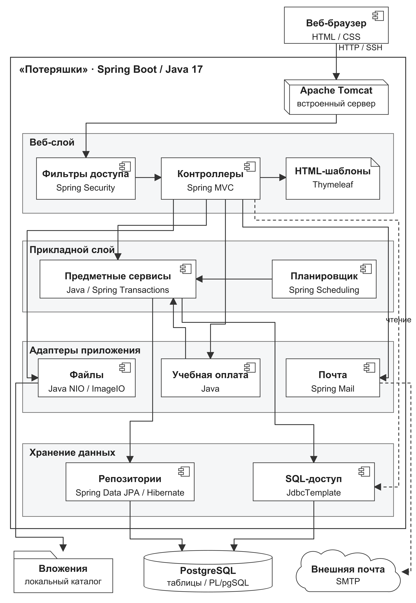

### 6.2. Компоненты и распределение ответственности

| Компонент | Вход и результат | Основные зависимости |
| --- | --- | --- |
| WebSessions, WebIdentity, Spring Security | Проверенный сеанс и идентификатор действующего пользователя | Хеши паролей, версии токенов и отозванные сеансы в PostgreSQL |
| MVC-контроллеры | Параметры форм; модель страницы либо перенаправление | Сервисы предметной области и Thymeleaf |
| WebQueries | Проекции для каталога, кабинета и очередей | SqlStore и проверки доступа; публичные проекции исключают секреты |
| AccountService, SubscriptionService | Подтверждённый профиль, заказ и оплаченный период; UC-01 | AccessPolicy, почтовый и платёжный адаптеры, DatabaseFunctions |
| ListingService | Черновик, публикация, фильтры и карточка; UC-02 и начало UC-03 | AccessPolicy, SqlStore, поиск PL/pgSQL и файловый адаптер |
| ReturnService | Заявка, диалог, резерв и подтверждения; UC-03 | Проверка участников и функции резервирования и передачи |
| AdministrationService | Жалоба, служебное решение, роли, тарифы, организации; UC-04, служебное управление | AccessPolicy, SqlStore и неизменяемый аудит |
| AuctionService | Допуск, лот, ставка и итог; UC-05 | Функции торгов, запись находки и проверка права продавца |
| OutboxService, WebJobs | Доставка уведомлений и закрытие истёкших торгов | Очередь событий и процедура PostgreSQL; повторная обработка безопасна |
| SqlStore, репозитории JPA, DatabaseFunctions | Параметризованные операции хранения | JDBC-пул и схема PostgreSQL |
| PrivateFiles, MediaPages | Проверенный файл и разрешённая выдача | Закрытый каталог и проверка владельца либо служебных полномочий |

Роль инициатора определяется по проверенному сеансу. Контроллер не принимает идентификатор действующего пользователя из скрытого поля формы. AccessPolicy проверяет роль, состояние профиля, подписку и принадлежность объекта в серверном коде; скрытие кнопки не заменяет эту проверку. Для модератора отдельно проверяется отсутствие заинтересованности в рассматриваемом деле.

Модели Thymeleaf содержат только сведения, нужные странице. Пароли, хеши токенов и чужие закрытые признаки в них не включаются. Служебная очередь и публичный каталог используют разные проекции. Шаблоны находятся в src/main/resources/templates, стили — в src/main/resources/static и включаются в JAR.

### 6.3. Обработка запроса на примере возврата

1. Владелец открывает опубликованную находку. Spring Security проверяет токен и текущий сеанс; контроллер получает идентификатор пользователя через WebIdentity.
2. Контроллер передаёт заявку и доказательства в ReturnService. AccessPolicy проверяет доступ, сервис создаёт заявку и диалог в одной транзакции и сохраняет событие уведомления.
3. Нашедший открывает дело из своего кабинета. Проверка принадлежности даёт доступ только участникам заявки; во время открытого спора допускается независимый модератор.
4. После уточнений нашедший подтверждает согласование. DatabaseFunctions вызывает lf_reserve_found; функция блокирует находку, проверяет отсутствие другого резерва и создаёт передачу.
5. Первое подтверждение вызывает lf_confirm_transfer и сохраняет одну отметку. Второе завершает передачу, заявку и состояние находки той же функцией.
6. Контроллер возвращает обновлённую страницу. OutboxService доставляет уведомления после фиксации транзакции. Ошибка внешнего адаптера не отменяет уже сохранённый результат возврата.

В UC-03 нашедший и владелец используют разные учётные записи. Их обращения поступают через контроллеры; проверка прав, резервирование и подтверждение передачи выполняются на сервере.

### 6.4. Хранение и транзакционные границы

В PostgreSQL размещаются учётные записи, назначения ролей, токены, проверки профилей, тарифы и заказы, подписки, объявления, справочники, заявки, сообщения, передачи, жалобы, допуски, аукционы, ставки, уведомления, очередь событий и аудит. Таблица назначений ролей образует связь M:N между пользователями и ролями. Конкретные таблицы, атрибуты и ограничения разрабатываются на втором этапе.

Критичные операции реализуются функциями PL/pgSQL: активация подписки, поиск, резервирование, подтверждение передачи, приём ставки и завершение торгов. Третий этап должен вызывать эти функции из Java, сохраняя правила и блокировки в базе. Прикладной слой проверяет пользователя, подготавливает параметры и обрабатывает результат.

| Операция | Транзакционная граница | Защита от конфликта |
| --- | --- | --- |
| Оплата подписки | Событие оплаты и один оплаченный период | Ключ события, блокировки пользователя и заказа, отсутствие повторного продления |
| Согласование возврата | Принятая заявка, резерв, передача и событие | Блокировка находки, один действующий резерв и отсутствие незавершённых торгов |
| Подтверждение передачи | Отметка стороны либо завершение всего дела | Блокировка состояния дела и проверка участников |
| Приём ставки | Проверенная ставка и событие уведомления | Единый порядок блокировок: находка, затем аукцион; повторная проверка времени и цены |
| Завершение торгов | Победитель, итог и единственное дело передачи | Те же блокировки, запрет ставки после окончания, идемпотентный повтор |
| Служебное решение | Изменение состояния и аудит | Проверка независимости, полномочий и допустимого перехода |

Для денежных значений применяется NUMERIC(12,2), для моментов времени — timestamptz. Ввод и отображение используют Europe/Moscow. Поиск выполняется средствами PostgreSQL: индексы по месту, категории, типу и состоянию, полнотекстовый индекс по русскому описанию. Состав и полезность индексов обосновываются на втором этапе по прецедентам.

Outbox хранит событие вместе с бизнес-изменением в одной транзакции. Отдельный обработчик выбирает недоставленные записи, создаёт внутренние уведомления и отмечает доставку. Аудит фиксирует исполнителя, объект, действие, время и результат; пользовательские операции не редактируют журнал.

### 6.5. Файлы и внешние интеграции

Фотографии и подтверждающие материалы хранятся отдельно от статических ресурсов. В базе находятся ключ файла, тип, размер и связь с объявлением либо допуском. Фотография декодируется, проверяется и пересохраняется без исходных метаданных. Выдача файла идёт через контроллер с проверкой прав. Документ допуска доступен продавцу и модератору; публичный каталог его не раскрывает.

Для учебной установки выбран закрытый локальный каталог STORAGE_ROOT. MinIO может заменить файловый адаптер при дальнейшем развитии; такой вариант требует настройки закрытого бакета и совместного резервного копирования базы и объектов. Он не является зависимостью первоначального запуска на helios.

Платёжный адаптер подтверждает оплату подписки, а не расчёт между продавцом и покупателем лота. Учебный режим не списывает средства и проверяет повторные результаты. При подключении внешнего провайдера результат должен проверяться адаптером до вызова функции активации подписки.

Почтовый интерфейс используется для подтверждения адреса и восстановления доступа. В учебном режиме письма доступны получателю в его кабинете; для внешней доставки предусмотрены параметры SMTP и STARTTLS. Внутренние уведомления сохраняются в PostgreSQL независимо от почтовой доставки.

Справочная интеграция метро читает данные из справочника организаций. Администратор обновляет запись по официальному источнику согласно FR-07. Запрос к каталогу или инструкции не зависит от доступности сайта метрополитена; прямой обмен реестрами не предусматривается.

## Вывод

Определены предметная область, три роли доступа и пять подробных прецедентов с законченным результатом. Описаны взаимодействия участников, модератора и администратора, основные и альтернативные потоки. Сформулированы десять функциональных и шесть нефункциональных требований, соответствующих учебной реализации. Архитектура разделяет представление, проверку сеанса, предметные сервисы, хранение и адаптеры. Java-приложение на Spring MVC и Thymeleaf размещается на helios, данные — в PostgreSQL, вложения — в закрытом каталоге. MinIO рассматривается как расширение файлового адаптера.

Второй этап включает ER-модель, даталогическую модель, схему PostgreSQL, ограничения и триггеры, тестовые данные, функции PL/pgSQL и индексы. Реализация интерфейса и серверного приложения относится к последующим этапам.

## Список использованных источников

Дата проверки источников: 03.10.2026. Контакты и условия организации подлежат повторной проверке перед эксплуатацией. Все проектные требования и численные цели сформулированы для данной курсовой; они не являются требованиями метрополитена.

1. Петербургский метрополитен. Справочная о забытых вещах. Официальный источник порядка хранения и получения: https://metro.spb.ru/zabitieveshy.html?v=1
2. Петербургский метрополитен. Контакты. Проверка телефона информационно-справочного центра: https://metro.spb.ru/contacts.html
3. Гражданский кодекс Российской Федерации, часть первая, статья 227 «Находка». Текст нормы в СПС «КонсультантПлюс»: https://www.consultant.ru/document/cons_doc_LAW_5142/b3526f37d7093a56bf084817caeee175f032a3d7/
4. Гражданский кодекс Российской Федерации, часть первая, статья 228 «Приобретение права собственности на находку». Текст нормы в СПС «КонсультантПлюс»: https://www.consultant.ru/document/cons_doc_LAW_5142/104dea7aa78d4c2e927d3baed4e96d5ace10e692/
5. Spring. Spring Boot 3.5 — System Requirements. Официальная документация: https://docs.spring.io/spring-boot/3.5/system-requirements.html
6. Кафедра ВТ, Университет ИТМО. Программирование. Публичные задания с демонстрацией Java-программ на helios: https://se.ifmo.ru/courses/programming
7. MyFilmList. Backend, build.gradle, версия 74d1928973cae329d6ca651bac2ffde445a43de0: https://github.com/maxbarsukov/MyFilmList/blob/74d1928973cae329d6ca651bac2ffde445a43de0/build.gradle
8. Spring Framework. Thymeleaf: https://docs.spring.io/spring-framework/reference/web/webmvc-view/mvc-thymeleaf.html
9. Thymeleaf. Интеграция со Spring: https://www.thymeleaf.org/doc/tutorials/3.1/thymeleafspring.html

## Приложение А. Термины

| Термин | Определение |
| --- | --- |
| Верификация профиля | Подтверждение почты и решение модератора о допуске аккаунта; не паспортная идентификация |
| Подписка | Оплаченный период доступа к пользовательским функциям |
| Контрольный признак | Непубличная характеристика вещи для проверки претендента |
| Резервирование | Согласование выдачи одной находки одному претенденту |
| Справочная интеграция | Подбор проверенных контактов и инструкций организации без обмена её внутренними данными |
| Допуск аукциона | Решение модератора по материалам основания распоряжения вещью |
| Идемпотентность | Повтор запроса или события не создаёт повторный результат операции |
| Outbox | Таблица событий, записываемых вместе с бизнес-операцией для последующей надёжной доставки |

## Приложение Б. Соответствие заданию и проверка требований

| Пункт задания | Раздел отчёта | Результат |
| --- | --- | --- |
| 1. Выбор предметной области | 1–2 | Поиск и возврат потерянных вещей в Санкт-Петербурге |
| 2. Подробное описание | 2 | Участники, процессы, данные и правила работы с находками |
| 3. Назначение системы | 3 | Цель и задачи автоматизации |
| 4. Требования | 4 | Десять функциональных и шесть нефункциональных требований |
| 5. Прецеденты | 5 | Пять подробных процессов и отдельная диаграмма каждого |
| 6. Архитектура | 6 | Общая схема приложения, PostgreSQL, файлов и доступа через helios |
| 7. Отчёт | Весь документ | Анализ предметной области и проектирование системы |

| Прецедент | Связанные функциональные требования |
| --- | --- |
| UC-01. Получить доступ к сервису | FR-01, FR-02, FR-03, FR-10 |
| UC-02. Опубликовать находку | FR-04, FR-10 |
| UC-03. Вернуть вещь владельцу | FR-05, FR-06, FR-07, FR-10 |
| UC-04. Разрешить спор о находке | FR-06, FR-08, FR-10 |
| UC-05. Продать вещь на аукционе | FR-06, FR-09, FR-10 |

Функциональные требования проверяются прохождением этих пяти процессов с разными учётными записями. В UC-03 отдельно проверяется обращение к справочнику метро вместо личной заявки на вещь, переданную организации. Демонстрационная оплата не требует подключения платёжного провайдера.

Для NFR-01 проверяются формы на компьютере и телефоне; для NFR-02 — отказ в доступе к чужим материалам; для NFR-03 — отсутствие исходных паролей в базе, ответах и журнале. NFR-04 проверяется параллельным резервированием и откатом неуспешной операции, NFR-05 — повтором одного запроса или события. NFR-06 проверяется запуском JAR с указанным ограничением heap и доступом через SSH-туннель к PostgreSQL и файлам курсовой.


## Задание второго этапа

Второй этап курсовой работы включает:

1. Построение ER-модели не менее чем с 10 сущностями и связью «многие ко многим».
2. Построение даталогической модели на основе ER-модели.
3. Реализацию модели в PostgreSQL.
4. Обеспечение целостности средствами DDL и триггеров.
5. Скрипты создания, удаления и заполнения тестовыми данными.
6. Функции и процедуры PL/pgSQL для критически важных запросов.
7. Индексы по прецедентам первого этапа и обоснование их полезности.
8. Подготовку отчёта.

## 7. ER-модель базы данных

### 7.1. Сущности и связи

Модель построена по процессам и прецедентам первого этапа и содержит 27 сущностей: пользователи, роли, назначения ролей, проверки профилей, одноразовые токены, токены обновления, тарифы, заказы оплаты, платёжные события, периоды подписки, организации, места, категории, объявления, изображения, контрольные признаки, заявки на передачу, диалоги, сообщения, передачи, жалобы, допуски к продаже, аукционы, ставки, уведомления, события доставки и записи аудита.

Пользователь может иметь несколько ролей, а одна роль назначается нескольким пользователям. Отношение «многие ко многим» реализовано ассоциативной сущностью «Назначение роли»: lf_user_roles(user_id, role_code). Составной первичный ключ исключает повторное назначение одной роли пользователю.

Объявление принадлежит одному автору, одной категории и одному месту. Место может быть связано с организацией, предоставляющей справочную информацию. Организация-хранитель находки задаётся отдельно: событие могло произойти в одном месте, а вещь передана другой организации. Поле custodian_org_id не означает партнёрство организации с приложением.

Заявка связывает находку с претендентом. У находки может быть несколько заявок, но один действующий резерв. Диалог и передача относятся к конкретной заявке; участники определяются через автора объявления и заявителя. Необязательный auction_id с внешним ключом и UNIQUE связывает дело передачи с завершённым аукционом: одному аукциону соответствует не более одного такого дела. Допуск к продаже относится к находке и продавцу; каждый аукцион использует конкретный допуск. Это исключает подстановку разрешения для другой вещи. Всего модель содержит 42 внешних ключа.

Заказ оплаты фиксирует стоимость и длительность тарифа на момент создания. Изменение справочника тарифов не меняет уже созданный заказ. Внешние события оплаты отделены от периодов подписки, поскольку платёжный сервис может повторить событие. Одному оплаченному заказу соответствует не более одного периода.

Уведомление адресовано пользователю. Событие доставки содержит тип агрегата, его идентификатор и JSON-параметры; эта техническая очередь не имеет универсального внешнего ключа на разные таблицы. Аудит хранит таблицу и идентификатор изменённой сущности. Его actor_id может быть NULL для фоновой операции.

### 7.2. Диаграммы

Модель разделена на шесть листов для чтения в формате A4. Листы показывают основные связи и их мощности; повтор сущности на разных листах не означает дополнительную таблицу. Полный перечень внешних ключей и атрибутов приведён в даталогической модели и словаре отношений. Обозначения: 1 — ровно один, 0..1 — необязательный экземпляр, 0..N — множество.

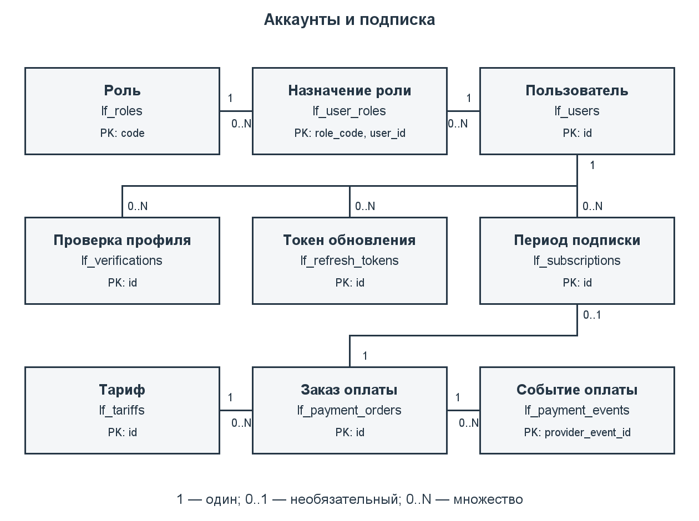

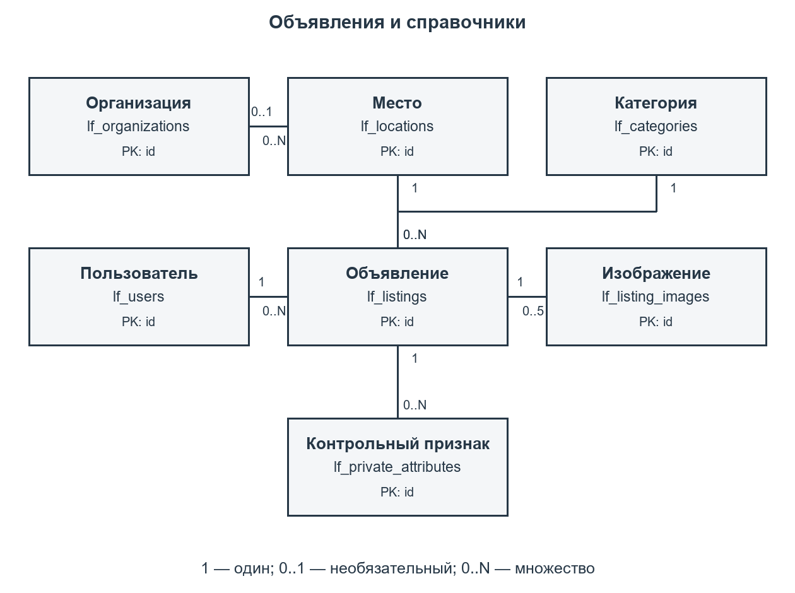

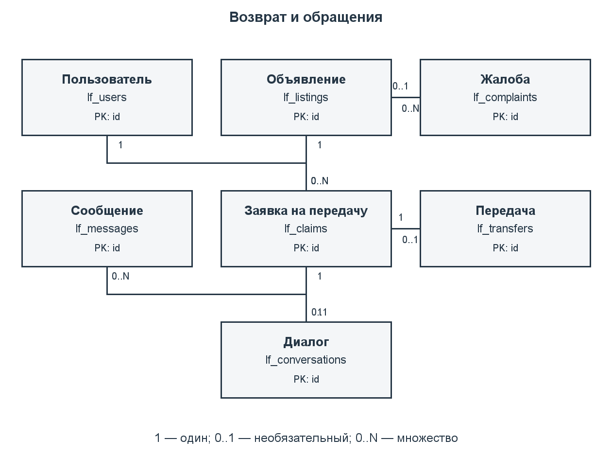

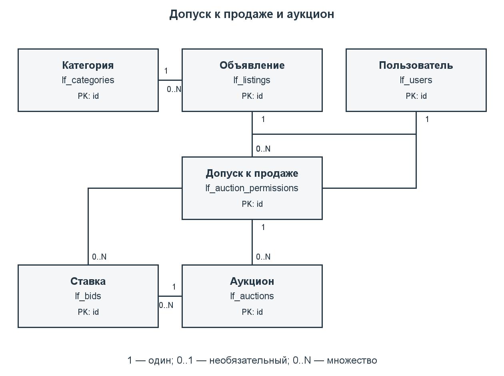

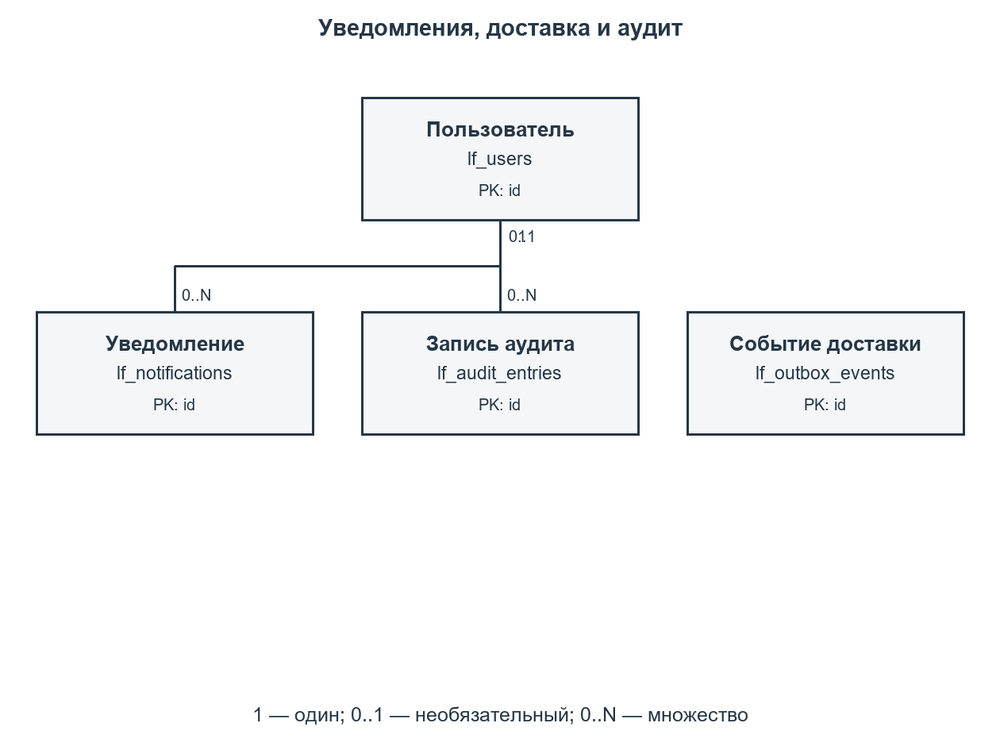

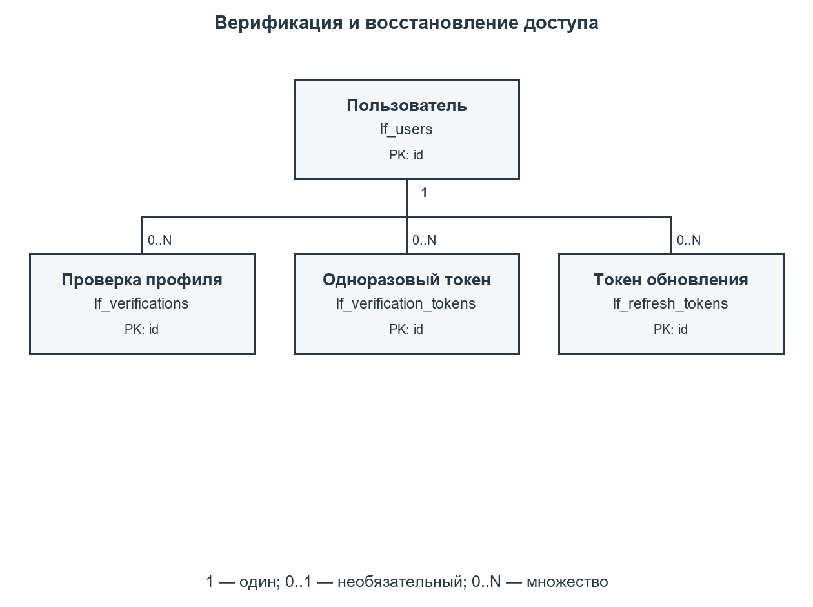

Редактируемая концептуальная модель находится в docs/part2/model/er.mmd, полная даталогическая схема — в logical.mmd. Формат Mermaid поддерживает отображение ER-диаграмм и связей с ключами. Изображения каждого листа предоставлены в PNG и SVG.

## 8. Даталогическая модель

### 8.1. Преобразование ER-модели

Каждая сущность преобразована в таблицу PostgreSQL. Основные идентификаторы — bigint GENERATED BY DEFAULT AS IDENTITY; код роли является естественным ключом. Для ассоциации пользователей и ролей выбран составной ключ. Связи 1:N реализованы внешними ключами; для связей 1:0..1 добавлено UNIQUE: заявка — диалог, заявка — передача и заказ оплаты — период подписки.

Модель приведена к третьей нормальной форме. Атрибуты пользователя не копируются в объявления, диалоги и ставки. Сведения о категории, месте, организации и тарифе вынесены в справочники. Составной ключ назначения роли не содержит атрибутов, зависящих только от одной его части. Снимок суммы и длительности в заказе относится к самому заказу и необходим для сохранения условий оплаты, поэтому не заменяется ссылкой на текущие значения тарифа.

Время хранится в timestamptz. Начало события обязательно; event_until задаётся только для интервала потери. Денежные значения используют numeric(12,2), без float. Закрытые признаки хранятся в lf_private_attributes и отсутствуют в публичном представлении. Файлы представлены ключами вложений закрытого локального каталога; бинарные данные не записываются в PostgreSQL. Технические JSON-поля применяются только в очереди событий и аудите, а связи предметной области остаются реляционными.

Циклическая связь аукциона и выигравшей ставки реализована составным внешним ключом (id, winner_bid_id) → lf_bids(auction_id, id), отложенным до завершения транзакции. Победитель не может относиться к другому аукциону. Отложенная проверка резерва позволяет в одной транзакции согласовать заявку и изменить статус объявления. Физический столбец search_vector является контролируемой избыточностью для поиска: PostgreSQL вычисляет его из текста объявления автоматически; в концептуальной нормализованной модели этот атрибут не требуется.

Словарь отношений сформирован из системного каталога PostgreSQL после установки на helios. Он отражает реально созданные типы, возможность NULL, первичные и внешние ключи. Отдельные частичные уникальные индексы описаны в разделе 13.

### 8.2. Словарь отношений

#### 1. Допуск к продаже: lf_auction_permissions

| Поле | Тип PostgreSQL | NULL | Ключ |
| --- | --- | --- | --- |
| id | bigint | Нет | PK |
| listing_id | bigint | Нет | FK |
| applicant_id | bigint | Нет | FK |
| basis | varchar(20) | Нет | — |
| evidence_object_key | varchar(240) | Нет | — |
| state | varchar(12) | Нет | — |
| moderator_id | bigint | Да | FK |
| reviewed_at | timestamptz | Да | — |
| reason | text | Да | — |
| created_at | timestamptz | Нет | — |

FOREIGN KEY (applicant_id) REFERENCES lf_users(id).

UNIQUE (id, listing_id, applicant_id).

FOREIGN KEY (listing_id) REFERENCES lf_listings(id).

FOREIGN KEY (moderator_id) REFERENCES lf_users(id).

PRIMARY KEY (id).

#### 2. Аукцион: lf_auctions

| Поле | Тип PostgreSQL | NULL | Ключ |
| --- | --- | --- | --- |
| id | bigint | Нет | PK, FK |
| listing_id | bigint | Нет | FK |
| seller_id | bigint | Нет | FK |
| permission_id | bigint | Нет | FK |
| starts_at | timestamptz | Нет | — |
| ends_at | timestamptz | Нет | — |
| start_price | numeric(12,2) | Нет | — |
| bid_step | numeric(12,2) | Нет | — |
| state | varchar(12) | Нет | — |
| winner_bid_id | bigint | Да | FK |
| closed_at | timestamptz | Да | — |

FOREIGN KEY (listing_id) REFERENCES lf_listings(id).

FOREIGN KEY (permission_id, listing_id, seller_id) REFERENCES lf_auction_permissions(id, listing_id, applicant_id).

PRIMARY KEY (id).

FOREIGN KEY (seller_id) REFERENCES lf_users(id).

FOREIGN KEY (id, winner_bid_id) REFERENCES lf_bids(auction_id, id) DEFERRABLE INITIALLY DEFERRED.

#### 3. Запись аудита: lf_audit_entries

| Поле | Тип PostgreSQL | NULL | Ключ |
| --- | --- | --- | --- |
| id | bigint | Нет | PK |
| actor_id | bigint | Да | FK |
| action | varchar(80) | Нет | — |
| entity_table | varchar(80) | Нет | — |
| entity_id | bigint | Нет | — |
| details | jsonb | Нет | — |
| created_at | timestamptz | Нет | — |

FOREIGN KEY (actor_id) REFERENCES lf_users(id).

PRIMARY KEY (id).

#### 4. Ставка: lf_bids

| Поле | Тип PostgreSQL | NULL | Ключ |
| --- | --- | --- | --- |
| id | bigint | Нет | PK |
| auction_id | bigint | Нет | FK |
| bidder_id | bigint | Нет | FK |
| request_key | uuid | Нет | — |
| amount | numeric(12,2) | Нет | — |
| placed_at | timestamptz | Нет | — |

FOREIGN KEY (auction_id) REFERENCES lf_auctions(id).

UNIQUE (auction_id, id).

FOREIGN KEY (bidder_id) REFERENCES lf_users(id).

PRIMARY KEY (id).

UNIQUE (request_key).

#### 5. Категория: lf_categories

| Поле | Тип PostgreSQL | NULL | Ключ |
| --- | --- | --- | --- |
| id | bigint | Нет | PK |
| name | varchar(80) | Нет | — |
| auction_allowed | boolean | Нет | — |

UNIQUE (name).

PRIMARY KEY (id).

#### 6. Заявка на передачу: lf_claims

| Поле | Тип PostgreSQL | NULL | Ключ |
| --- | --- | --- | --- |
| id | bigint | Нет | PK |
| listing_id | bigint | Нет | FK |
| claimant_id | bigint | Нет | FK |
| evidence | text | Нет | — |
| state | varchar(12) | Нет | — |
| created_at | timestamptz | Нет | — |
| auction_id | bigint | Да | FK |

FOREIGN KEY (auction_id) REFERENCES lf_auctions(id).

UNIQUE (auction_id).

FOREIGN KEY (claimant_id) REFERENCES lf_users(id).

UNIQUE (id, listing_id).

FOREIGN KEY (listing_id) REFERENCES lf_listings(id).

PRIMARY KEY (id).

#### 7. Жалоба: lf_complaints

| Поле | Тип PostgreSQL | NULL | Ключ |
| --- | --- | --- | --- |
| id | bigint | Нет | PK |
| reporter_id | bigint | Нет | FK |
| listing_id | bigint | Да | FK |
| reported_user_id | bigint | Да | FK |
| reason | text | Нет | — |
| state | varchar(12) | Нет | — |
| moderator_id | bigint | Да | FK |
| resolution | text | Да | — |
| created_at | timestamptz | Нет | — |

FOREIGN KEY (listing_id) REFERENCES lf_listings(id).

FOREIGN KEY (moderator_id) REFERENCES lf_users(id).

PRIMARY KEY (id).

FOREIGN KEY (reported_user_id) REFERENCES lf_users(id).

FOREIGN KEY (reporter_id) REFERENCES lf_users(id).

#### 8. Диалог: lf_conversations

| Поле | Тип PostgreSQL | NULL | Ключ |
| --- | --- | --- | --- |
| id | bigint | Нет | PK |
| claim_id | bigint | Нет | FK |
| created_at | timestamptz | Нет | — |

FOREIGN KEY (claim_id) REFERENCES lf_claims(id).

UNIQUE (claim_id).

PRIMARY KEY (id).

#### 9. Изображение: lf_listing_images

| Поле | Тип PostgreSQL | NULL | Ключ |
| --- | --- | --- | --- |
| id | bigint | Нет | PK |
| listing_id | bigint | Нет | FK |
| object_key | varchar(240) | Нет | — |
| media_type | varchar(20) | Нет | — |
| size_bytes | integer | Нет | — |
| position | smallint | Нет | — |

FOREIGN KEY (listing_id) REFERENCES lf_listings(id) ON DELETE CASCADE.

UNIQUE (listing_id, "position").

UNIQUE (object_key).

PRIMARY KEY (id).

#### 10. Объявление: lf_listings

| Поле | Тип PostgreSQL | NULL | Ключ |
| --- | --- | --- | --- |
| id | bigint | Нет | PK |
| author_id | bigint | Нет | FK |
| category_id | bigint | Нет | FK |
| location_id | bigint | Нет | FK |
| kind | varchar(5) | Нет | — |
| title | varchar(120) | Нет | — |
| description | text | Нет | — |
| event_at | timestamptz | Нет | — |
| event_until | timestamptz | Да | — |
| state | varchar(12) | Нет | — |
| custodian_org_id | bigint | Да | FK |
| official_reported_at | timestamptz | Да | — |
| moderator_id | bigint | Да | FK |
| moderated_at | timestamptz | Да | — |
| created_at | timestamptz | Нет | — |
| search_vector | tsvector | Да | — |

FOREIGN KEY (author_id) REFERENCES lf_users(id).

FOREIGN KEY (category_id) REFERENCES lf_categories(id).

FOREIGN KEY (custodian_org_id) REFERENCES lf_organizations(id).

FOREIGN KEY (location_id) REFERENCES lf_locations(id).

FOREIGN KEY (moderator_id) REFERENCES lf_users(id).

PRIMARY KEY (id).

#### 11. Место: lf_locations

| Поле | Тип PostgreSQL | NULL | Ключ |
| --- | --- | --- | --- |
| id | bigint | Нет | PK |
| city | varchar(80) | Нет | — |
| description | varchar(240) | Нет | — |
| latitude | numeric(9,6) | Да | — |
| longitude | numeric(9,6) | Да | — |
| metro_station | varchar(100) | Да | — |
| organization_id | bigint | Да | FK |

FOREIGN KEY (organization_id) REFERENCES lf_organizations(id).

PRIMARY KEY (id).

#### 12. Сообщение: lf_messages

| Поле | Тип PostgreSQL | NULL | Ключ |
| --- | --- | --- | --- |
| id | bigint | Нет | PK |
| conversation_id | bigint | Нет | FK |
| sender_id | bigint | Нет | FK |
| body | text | Нет | — |
| sent_at | timestamptz | Нет | — |

FOREIGN KEY (conversation_id) REFERENCES lf_conversations(id).

PRIMARY KEY (id).

FOREIGN KEY (sender_id) REFERENCES lf_users(id).

#### 13. Уведомление: lf_notifications

| Поле | Тип PostgreSQL | NULL | Ключ |
| --- | --- | --- | --- |
| id | bigint | Нет | PK |
| user_id | bigint | Нет | FK |
| kind | varchar(40) | Нет | — |
| body | text | Нет | — |
| read_at | timestamptz | Да | — |
| created_at | timestamptz | Нет | — |

PRIMARY KEY (id).

FOREIGN KEY (user_id) REFERENCES lf_users(id).

#### 14. Организация: lf_organizations

| Поле | Тип PostgreSQL | NULL | Ключ |
| --- | --- | --- | --- |
| id | bigint | Нет | PK |
| name | varchar(160) | Нет | — |
| phone | varchar(40) | Нет | — |
| address | text | Да | — |
| instructions | text | Нет | — |
| source_url | text | Нет | — |
| verified_on | date | Нет | — |

UNIQUE (name).

PRIMARY KEY (id).

#### 15. Событие доставки: lf_outbox_events

| Поле | Тип PostgreSQL | NULL | Ключ |
| --- | --- | --- | --- |
| id | bigint | Нет | PK |
| kind | varchar(40) | Нет | — |
| aggregate_id | bigint | Нет | — |
| payload | jsonb | Нет | — |
| attempts | integer | Нет | — |
| next_attempt_at | timestamptz | Нет | — |
| delivered_at | timestamptz | Да | — |
| created_at | timestamptz | Нет | — |

PRIMARY KEY (id).

#### 16. Событие оплаты: lf_payment_events

| Поле | Тип PostgreSQL | NULL | Ключ |
| --- | --- | --- | --- |
| provider_event_id | varchar(100) | Нет | PK |
| order_id | bigint | Нет | FK |
| amount | numeric(12,2) | Нет | — |
| currency | char(3) | Нет | — |
| received_at | timestamptz | Нет | — |

FOREIGN KEY (order_id) REFERENCES lf_payment_orders(id).

PRIMARY KEY (provider_event_id).

#### 17. Заказ оплаты: lf_payment_orders

| Поле | Тип PostgreSQL | NULL | Ключ |
| --- | --- | --- | --- |
| id | bigint | Нет | PK |
| user_id | bigint | Нет | FK |
| tariff_id | bigint | Нет | FK |
| request_key | uuid | Нет | — |
| amount | numeric(12,2) | Нет | — |
| duration_days | integer | Нет | — |
| currency | char(3) | Нет | — |
| state | varchar(12) | Нет | — |
| created_at | timestamptz | Нет | — |
| paid_at | timestamptz | Да | — |

PRIMARY KEY (id).

UNIQUE (request_key).

FOREIGN KEY (tariff_id) REFERENCES lf_tariffs(id).

FOREIGN KEY (user_id) REFERENCES lf_users(id).

#### 18. Контрольный признак: lf_private_attributes

| Поле | Тип PostgreSQL | NULL | Ключ |
| --- | --- | --- | --- |
| id | bigint | Нет | PK |
| listing_id | bigint | Нет | FK |
| name | varchar(80) | Нет | — |
| value | text | Нет | — |

FOREIGN KEY (listing_id) REFERENCES lf_listings(id) ON DELETE CASCADE.

UNIQUE (listing_id, name).

PRIMARY KEY (id).

#### 19. Токен обновления: lf_refresh_tokens

| Поле | Тип PostgreSQL | NULL | Ключ |
| --- | --- | --- | --- |
| id | bigint | Нет | PK |
| user_id | bigint | Нет | FK |
| token_hash | varchar(64) | Нет | — |
| expires_at | timestamptz | Нет | — |
| revoked_at | timestamptz | Да | — |
| created_at | timestamptz | Нет | — |

PRIMARY KEY (id).

UNIQUE (token_hash).

FOREIGN KEY (user_id) REFERENCES lf_users(id).

#### 20. Роль: lf_roles

| Поле | Тип PostgreSQL | NULL | Ключ |
| --- | --- | --- | --- |
| code | varchar(16) | Нет | PK |
| title | varchar(80) | Нет | — |

PRIMARY KEY (code).

#### 21. Период подписки: lf_subscriptions

| Поле | Тип PostgreSQL | NULL | Ключ |
| --- | --- | --- | --- |
| id | bigint | Нет | PK |
| user_id | bigint | Нет | FK |
| payment_order_id | bigint | Нет | FK |
| starts_at | timestamptz | Нет | — |
| ends_at | timestamptz | Нет | — |

FOREIGN KEY (payment_order_id) REFERENCES lf_payment_orders(id).

UNIQUE (payment_order_id).

PRIMARY KEY (id).

FOREIGN KEY (user_id) REFERENCES lf_users(id).

#### 22. Тариф: lf_tariffs

| Поле | Тип PostgreSQL | NULL | Ключ |
| --- | --- | --- | --- |
| id | bigint | Нет | PK |
| title | varchar(80) | Нет | — |
| amount | numeric(12,2) | Нет | — |
| duration_days | integer | Нет | — |
| active | boolean | Нет | — |

PRIMARY KEY (id).

#### 23. Передача: lf_transfers

| Поле | Тип PostgreSQL | NULL | Ключ |
| --- | --- | --- | --- |
| id | bigint | Нет | PK |
| claim_id | bigint | Нет | FK |
| finder_confirmed_at | timestamptz | Да | — |
| owner_confirmed_at | timestamptz | Да | — |
| moderator_id | bigint | Да | FK |
| override_reason | text | Да | — |
| completed_at | timestamptz | Да | — |

FOREIGN KEY (claim_id) REFERENCES lf_claims(id).

UNIQUE (claim_id).

FOREIGN KEY (moderator_id) REFERENCES lf_users(id).

PRIMARY KEY (id).

#### 24. Назначение роли: lf_user_roles

| Поле | Тип PostgreSQL | NULL | Ключ |
| --- | --- | --- | --- |
| user_id | bigint | Нет | PK, FK |
| role_code | varchar(16) | Нет | PK, FK |

PRIMARY KEY (user_id, role_code).

FOREIGN KEY (role_code) REFERENCES lf_roles(code) ON DELETE RESTRICT.

FOREIGN KEY (user_id) REFERENCES lf_users(id) ON DELETE RESTRICT.

#### 25. Пользователь: lf_users

| Поле | Тип PostgreSQL | NULL | Ключ |
| --- | --- | --- | --- |
| id | bigint | Нет | PK |
| email | varchar(254) | Нет | — |
| display_name | varchar(80) | Нет | — |
| password_hash | varchar(100) | Нет | — |
| state | varchar(12) | Нет | — |
| email_confirmed_at | timestamptz | Да | — |
| token_version | integer | Нет | — |
| created_at | timestamptz | Нет | — |

UNIQUE (email).

PRIMARY KEY (id).

#### 26. Одноразовый токен: lf_verification_tokens

| Поле | Тип PostgreSQL | NULL | Ключ |
| --- | --- | --- | --- |
| id | bigint | Нет | PK |
| user_id | bigint | Нет | FK |
| purpose | varchar(16) | Нет | — |
| token_hash | varchar(64) | Нет | — |
| expires_at | timestamptz | Нет | — |
| consumed_at | timestamptz | Да | — |
| created_at | timestamptz | Нет | — |

PRIMARY KEY (id).

UNIQUE (token_hash).

FOREIGN KEY (user_id) REFERENCES lf_users(id).

#### 27. Проверка профиля: lf_verifications

| Поле | Тип PostgreSQL | NULL | Ключ |
| --- | --- | --- | --- |
| id | bigint | Нет | PK |
| user_id | bigint | Нет | FK |
| state | varchar(12) | Нет | — |
| reviewer_id | bigint | Да | FK |
| reason | text | Да | — |
| created_at | timestamptz | Нет | — |
| reviewed_at | timestamptz | Да | — |

PRIMARY KEY (id).

FOREIGN KEY (reviewer_id) REFERENCES lf_users(id).

FOREIGN KEY (user_id) REFERENCES lf_users(id).


## 9. Реализация в PostgreSQL

### 9.1. Окружение и размещение

Работа установлена 03.10.2026 на helios.cs.ifmo.ru, SSH-порт 2222, учётная запись s465826. Сервер работает под FreeBSD 14.5-STABLE. Доступны PostgreSQL 18.3 и OpenJDK 21.0.4. Java понадобится для следующего этапа; на данном этапе выполняются SQL-скрипты и проверки модели данных.

Подключение к PostgreSQL: хост pg, база studs, схема s465826. У аккаунта есть CREATE в своей схеме, но нет CREATE для базы studs. Поэтому новая база или схема на helios не создаётся. Все таблицы, функции, индексы, триггеры и представление курсовой имеют префикс lf_. Данные другой лабораторной остаются в её существующих объектах.

Каталог на сервере — /home/studs/s465826/poteryashki-course. При создании схемы скрипт использует отдельную транзакцию и ON_ERROR_STOP; повторный запуск на уже созданных объектах останавливается. Удаление проверяет маркер курсовой у таблицы lf_users и перечисляет объекты явно, без DROP SCHEMA и без CASCADE. Внешняя зависимость вызовет ошибку и откат удаления.

### 9.2. Средства DDL

Первичные ключи обеспечивают идентификацию строк. Внешние ключи исключают ссылки на несуществующих пользователей, объявления и заявки. Большинство связей используют RESTRICT/NO ACTION; физическое удаление сущности с историей запрещено. Для изображений и контрольных признаков допускается каскадное удаление вместе с черновиком объявления, если на объявление нет препятствующих внешних ссылок.

CHECK ограничивает допустимые статусы, положительные цены и шаг ставок, интервал подписки и аукциона, размер изображения до 5 МиБ, позицию фотографии от 1 до 5, координаты и совместное наличие широты и долготы. При отклонении проверки или допуска обязательна непустая причина. У жалобы ровно один объект: объявление либо пользователь.

Пример связи допуска с лотом:

```sql
FOREIGN KEY (permission_id, listing_id, seller_id)
  REFERENCES lf_auction_permissions(id, listing_id, applicant_id)
```

Пример ограничения ставки-победителя:

```sql
FOREIGN KEY (id, winner_bid_id)
  REFERENCES lf_bids(auction_id, id)
  DEFERRABLE INITIALLY DEFERRED
```

Проверки, зависящие от текущего времени или других строк, вынесены в триггеры и функции. Например, CHECK не применяется для запрета ставки после окончания торгов: такая проверка должна выполняться при каждой операции под блокировкой.

## 10. Триггеры и целостность бизнес-процессов

| Группа триггеров | Что проверяется | Связанные прецеденты |
| --- | --- | --- |
| lf_user_guard, lf_user_block_auctions | Изменение пароля или статуса увеличивает token_version; блокировка продавца либо участника приостанавливает незавершённые торги | UC-01, UC-04 |
| lf_verification_guard | Роль проверяющего, подтверждённая почта; одобрение переводит профиль в verified | UC-01 |
| lf_payment_guard, lf_subscription_guard | Снимок тарифа, неизменность заказа; период только по оплаченному заказу; отсутствие пересечения периодов пользователя | UC-01 |
| lf_listing_guard | Допуск автора, отсутствие будущего события, права модератора, запрет самомодерации и повторная модерация существенных изменений | UC-02 |
| lf_claim_guard | Находка опубликована, заявитель не автор, допустимые переходы статуса; новая претензия приостанавливает торги | UC-03, UC-05 |
| lf_listing_reserved, lf_claim_reserved | В конце транзакции резерв соответствует ровно одной принятой заявке; возврат подтверждён передачей, продажа — завершённым аукционом | UC-03, UC-05 |
| lf_message_guard, lf_transfer_guard | Сообщение от участника либо служебной роли при открытой жалобе на эту находку; передача относится к принятой заявке; закрытая передача неизменяема; служебное решение требует модератора | UC-03, UC-04 |
| lf_permission_guard | Нет документов и вещей организации; проверка основания, официальной даты и роли; реквизиты рассмотренного допуска зафиксированы | UC-05 |
| lf_auction_guard, lf_bid_guard | Лот соответствует допуску и актуальному объявлению; допустимые статусы, время торгов, шаг, подписка; ставка продавца запрещена | UC-05 |
| lf_*_audit и lf_audit_immutable | Решения фиксируются без паролей, токенов и закрытых признаков; UPDATE, DELETE и TRUNCATE аудита запрещены | UC-01–05 |

Триггеры стоят на таблицах и действуют при прямом INSERT/UPDATE, а не только при вызове прикладных функций. Отложенные проверки выполняются при COMMIT. Отдельный частичный уникальный индекс немедленно исключает второй действующий резерв и второй незавершённый аукцион.

Операции возврата, ставок и закрытия сначала блокируют строку объявления, затем строку конкретного процесса. Активация подписки блокирует пользователя и заказ. Это сериализует конкурирующие изменения. После ожидания блокировки используется clock_timestamp(), поэтому истёкшее за время ожидания окно торгов не позволяет принять ставку.

Блокировка пользователя затрагивает несколько агрегатов. При столкновении с другой транзакцией PostgreSQL может вернуть SQLSTATE 40P01; прикладной слой должен откатить и ограниченно повторить всю транзакцию. Ошибка блокировки не обходится частичным повтором отдельных SQL-команд. Ошибки P0001 отражают бизнес-условие, 23505 — нарушение уникальности, 23514 — CHECK, 23503 — внешний ключ.

Роль владельца схемы технически может отключить триггеры или удалить объекты. Проверки рассчитаны на штатные DML-операции. В следующем этапе Spring Security удостоверяет пользователя и передаёт его идентификатор в функции; сам параметр p_user не является средством аутентификации БД. Функции используют SECURITY INVOKER и закреплённый search_path, не повышают права вызывающего.

## 11. Скрипты создания, удаления и заполнения

| Файл | Назначение |
| --- | --- |
| database/create.sql | Транзакционная установка таблиц, логики и индексов в указанную схему |
| database/01_tables.sql | 27 таблиц, типы столбцов, ключи и CHECK |
| database/02_logic.sql | PL/pgSQL, триггеры и публичное представление |
| database/03_indexes.sql | Индексы для бизнес-операций и ограничений |
| database/04_handover.sql | Связь дела передачи с аукционом, функции передачи победителю, ограничения отмены и доступа к диалогу; применяется также при обновлении |
| database/05_search.sql | Единый поиск по доступным публичным статусам и совместимый поиск активных объявлений |
| database/upgrade_web.sql | Транзакционное обновление существующего набора lf_ с проверкой маркера; восстановление недостающих дел передачи без удаления данных |
| database/seed.sql | Синтетические пользователи, находки, потеря, метро, возврат, подписки, аукцион и ставки |
| database/drop.sql | Удаление исключительно объектов курсовой с проверкой маркера и откатом при ошибке |
| database/create_database.sql | Создание отдельной локальной БД poteryashki_course и схемы poteryashki |
| database/drop_database.sql | Удаление только отдельной локальной БД poteryashki_course |
| database/test.sql | 50 проверок целостности в транзакции с ROLLBACK |
| database/explain.sql | Временный набор из 10 000 объявлений и EXPLAIN ANALYZE |
| tooling: команда db | Общая команда запуска SQL для helios |
| tooling: команда verify-db | Изолированный полный цикл установки/удаления и проверка двух соединений |

Команды psql запускаются на helios из каталога курсовой. Проверка verify-db запускается локально через SSH; пароль вводится скрыто:

```sh
java -Xmx256m -jar tooling/build/libs/course-tools.jar db create
java -Xmx256m -jar tooling/build/libs/course-tools.jar db seed
java -Xmx256m -jar tooling/build/libs/course-tools.jar db test
java -Xmx256m -jar tooling/build/libs/course-tools.jar verify-db
java -Xmx256m -jar tooling/build/libs/course-tools.jar db explain
```

Команда java -Xmx256m -jar tooling/build/libs/course-tools.jar db drop применяется только для сброса собственной курсовой; перед последующим create повторно запускается seed. Она не удаляет общую базу studs. Локальная установка требует роли, имеющей CREATE DATABASE:

```sh
psql -X -v ON_ERROR_STOP=1 -d postgres -f database/create_database.sql
psql -X -d poteryashki_course -v schema=poteryashki -f database/seed.sql
psql -X -d postgres -f database/drop_database.sql
```

Учебные email используют зарезервированный домен example.invalid. Значения цен, признаки и фотографии демонстрационные. В базе есть роли user/moderator/admin, подтверждённые и недопущенные профили, оплаченные периоды, семь объявлений, справочник метро, контрольные признаки, обращения и диалог, завершённая передача, жалоба, два допуска, один активный аукцион и две ставки. Пароли хранятся как BCrypt-хеши учебного значения; одноразовые и refresh-токены представлены синтетическими хешами. Во втором этапе проверяется модель данных; внешние платежи, отправка писем и загрузка вложений здесь не выполняются.

## 12. Функции и процедуры PL/pgSQL

| Подпрограмма | Параметры и результат | Алгоритм и назначение |
| --- | --- | --- |
| lf_consume_token | Хеш, назначение; user_id | Блокирует одноразовый токен, проверяет срок и повтор использования; подтверждает email либо разрешает продолжить смену пароля в той же транзакции |
| lf_activate_subscription | Заказ, ID события, сумма, валюта; subscription_id | Сверяет заказ и callback, исключает повтор, добавляет период от максимума текущего времени и конца оплаченного срока; сохраняет уведомление и outbox |
| lf_reserve_found | Заявка, нашедший; transfer_id | Блокирует находку, проверяет авторство, подписку и отсутствие торгов, принимает заявку, создаёт резерв и передачу; вещь организации выдаёт сама организация |
| lf_confirm_transfer | Передача, участник; boolean | Участник подтверждает свою сторону; два подтверждения переводят заявку в fulfilled, находку в returned. Для согласованной передачи продление подписки не требуется |
| lf_resolve_return | Передача, модератор, причина; void | Завершает согласованный возврат мотивированным решением сотрудника, фиксирует основание в передаче и событие аудита |
| lf_place_bid | Лот, участник, сумма, UUID; bid_id | Блокирует находку и лот, проверяет повтор ключа, время, подписку и минимальную цену; вставляет ставку и событие доставки |
| lf_finalize_auction | Лот; winner_bid_id либо NULL | Выбирает победителя, завершает лот и вызывает создание дела передачи; повтор возвращает сохранённого победителя; без ставок вещь остаётся опубликованной |
| lf_prepare_auction_handover | Завершённый лот; claim_id либо NULL | Создаёт одну принятую заявку победителя, диалог и передачу; резервирует вещь. Повтор возвращает прежнее дело и не меняет подтверждения. Истечение подписки после ставки не отменяет результат торгов |
| lf_close_due_auctions | Размер пакета от 1 до 1000 | Процедура обработки просроченных торгов. Приостановленные лоты не закрывает автоматически |
| lf_search_listings | Текст, тип, категория, место, время, курсор, лимит | Русский полнотекстовый поиск только опубликованных объявлений; лимит 1–100; порядок id DESC и курсор без OFFSET |
| lf_search_listings_state | Те же параметры и статус | Фильтр опубликованных, зарезервированных, переданных либо проданных вещей; черновики, отклонённые и непроверенные объявления никогда не возвращаются |

Вспомогательные lf_assert_user и lf_assert_moderator проверяют допуск профиля, оплаченный период и служебную роль. UUID ключа запроса ставки исключает повторное создание при повторной отправке клиентом. Повтор с тем же ключом и другим содержимым отклоняется. Событие оплаты также сверяется с исходным заказом, суммой и валютой.

Пример вызова ставок в одной транзакции:

```sql
BEGIN;
SET LOCAL search_path TO s465826, pg_catalog;
SELECT lf_place_bid(1, 4, 1200.00,
  '50000000-0000-0000-0000-000000000001');
COMMIT;
```

Идентификаторы примерные; повторять этот пример на учебном наборе можно только при доступном лоте и допустимой цене. В приложении параметры задаются через JDBC PreparedStatement или нативный запрос JPA. Для аудита прикладная транзакция задаёт set_config('lf.actor_id', user_id::text, true); фоновая операция оставляет actor_id пустым. Обработчик платежей вызывается после проверки подлинности серверного события выбранного провайдера.

## 13. Индексы и обоснование

### 13.1. Индексы по сценариям

Первичные ключи и UNIQUE создают индексы автоматически: email, хеши токенов, ключи запросов, ID внешнего события, соответствие передачи и диалога заявке. Внешний ключ PostgreSQL сам по себе не создаёт индекс на ссылающемся столбце; нужные индексы добавлены отдельно.

| Сценарий | Индексы из 03_indexes.sql | Польза |
| --- | --- | --- |
| Проверка профиля и ролей: UC-01 | lf_verification_pending_uq, lf_roles_reverse_idx | Один открытый запрос на пользователя; выбор сотрудников по роли |
| Авторизация и токены: UC-01 | lf_refresh_user_idx, lf_verification_token_user_idx | Выбор действующих сессий и неиспользованных токенов для отзыва/проверки |
| Подписка: UC-01 | lf_subscription_access_idx, lf_payment_user_idx, lf_payment_event_order_idx | Проверка срока, поиск конца оплаченного периода, кабинет платежей |
| Кабинет и модерация: UC-02 | lf_listing_author_idx, lf_listing_moderation_idx | Объявления автора и небольшая очередь ожидающих записей |
| Поиск: UC-03 | lf_listing_search_idx, lf_listing_place_idx, lf_listing_feed_idx, lf_listing_text_idx | Фильтры типа/категории/времени; место и диапазон; курсор ленты; GIN по русскому tsvector |
| Связи объявлений: UC-02, UC-03, FR-07 | lf_location_organization_idx, lf_listing_category_idx, lf_listing_location_idx, lf_listing_custodian_idx | Проверка ссылок и выбор связанных записей при работе со справочниками |
| Возврат и диалог: UC-03 | lf_claim_reserve_uq, lf_claim_open_uq, lf_claim_claimant_idx, lf_claim_listing_idx, lf_message_history_idx, lf_message_sender_idx | Один резерв; отсутствие повторной открытой заявки; обращения пользователя и последовательная история сообщений |
| Передача результата торгов: UC-05 | lf_claim_auction_unique | Не более одного дела передачи на аукцион; быстрый поиск для повторного завершения |
| Окончание подписки: UC-01 | lf_expiry_event_once | Частичный UNIQUE исключает повторное событие при параллельных обработчиках |
| Жалобы: UC-04 | lf_complaint_queue_idx, lf_complaint_reporter_idx, lf_complaint_listing_idx, lf_complaint_user_idx | Служебная очередь и разбор обращений по объекту |
| Допуск: UC-05 | lf_permission_listing_idx, lf_permission_applicant_idx | История оснований для вещи и продавца |
| Торги: UC-05 | lf_auction_open_uq, lf_auction_due_idx, lf_auction_seller_idx, lf_auction_permission_idx, lf_bid_winner_idx, lf_bid_user_idx | Один незавершённый лот; выбор просроченных торгов; максимальная ставка по auction_id/amount DESC/id; история участника |
| Уведомления и аудит: UC-01–05 | lf_notification_unread_idx, lf_outbox_pending_idx, lf_audit_entity_idx, lf_audit_actor_idx | Непрочитанные сообщения, очередь доставки, история сущности и действия сотрудника |

Частичные индексы включают только востребованные статусы. Они занимают меньше места и обслуживают очередь без просмотра завершённых записей. Уникальные частичные индексы являются также средством целостности. Составной индекс располагает поля равенства перед полем диапазона; порядок полей согласован с запросом.

### 13.2. Проверка планов

На helios выполнен EXPLAIN (ANALYZE, BUFFERS) на семи исходных и 10 000 временных объявлениях. Из временных 20% опубликованы, остальные архивные. Термин «термос» встречается в десяти опубликованных строках. После вставки очищается pending list GIN; в рабочей базе этим также занимается обслуживание индекса и autovacuum. Это проверка конкретных запросов, а не нагрузочный тест интерфейса или гарантия времени отклика.

С индексом полнотекстовый запрос использует Bitmap Index Scan по lf_listing_text_idx. После временного удаления GIN тот же запрос просматривает опубликованные объявления через B-tree и отбрасывает неподходящие строки. Поиск места и временного интервала использует lf_listing_place_idx; курсор ленты — lf_listing_feed_idx. Для двух исходных ставок PostgreSQL выбирает Seq Scan и сортировку: на столь малой таблице индекс победителя не обязательно выгоднее.

Полные планы, число строк, буферы и фактическое время сохранены в docs/part2/validation/indexes.txt. Временное удаление индекса и данные откатываются ROLLBACK; после отката обновляется статистика исходного набора. Выбор индекса зависит от объёма, распределения данных и конкретных параметров запроса.

## 14. Проверка реализации и демонстрация

### 14.1. Проверки целостности

Файл test.sql выполнил 50 проверок с ожидаемыми успехами и ошибками. Проверены уникальность почты и ролей, допуск и блокировка, условия модерации, сумма заказа, повтор события оплаты, сохранение оплаченного остатка, пересечение подписок, время события и интервал потери, лимит файлов, чужой диалог, дубликат заявки, второй резерв, подтверждения возврата и решение модератора.

Для аукционов проверены запрет продажи документов и вещей организации, официальная дата шестимесячного срока, запрет ставки продавца, шаг ставки, повтор ключа с другим содержимым, второй открытый лот, преждевременное завершение и приостановка после заявления владельца или блокировки участника. Также проверены неизменность истории и аудита, повтор одноразового токена и отсутствие закрытых полей в публичном представлении.

Проверки выполняются в транзакции и откатывают свои изменения. Последовательности identity могут получить пропуски: их значения не являются счётчиком строк и не откатываются вместе с транзакцией. Результат 50 PASS и ROLLBACK сохранён в docs/part2/validation/integrity.txt.

### 14.2. Конкурентные операции и жизненный цикл

Скрипт validate_database.py создаёт отдельный проверочный набор lfcheck_* в той же доступной схеме, применяя те же определения с другим префиксом. Если такие объекты уже существуют, скрипт останавливается и не удаляет их автоматически. После успешного создания он гарантированно запускает собственное удаление в finally. Основные lf_* и таблицы лабораторной в испытании не изменяются.

| Испытание | Результат |
| --- | --- |
| Две заявки одновременно получают резерв одной находки | Один резерв принят, второе соединение получает ошибку недоступности |
| Два участника одновременно предлагают одинаковую допустимую цену | Принята одна ставка, вторая отклонена после повторной проверки минимума |
| Два соединения обрабатывают одно событие оплаты нового заказа | Оба получают успешный результат; создан один период подписки |
| Короткий аукцион достигает времени окончания | Процедура определяет победителя; повторное завершение возвращает тот же ID |
| Создание, заполнение, проверка и удаление тестового набора | Полный цикл выполнен; объекты lfcheck_* удалены |
| Сравнение состава внешних объектов схемы до и после | Состав lf_* и объектов лабораторной сохранён |

Протокол находится в docs/part2/validation/concurrency.txt. Сведения об окружении и исходные объекты другой работы перечислены в environment.txt. Проверка касается сохранности структуры; операции скриптов не обращаются к данным другой лабораторной. Реализация Spring MVC/Thymeleaf, SMTP, файлового адаптера и внешнего платёжного адаптера на втором этапе ещё не выполнялась, поэтому проверки этих компонентов не представлены как успешные.

### 14.3. Порядок показа этапа 2

1. Показать ER-модель, связь пользователей и ролей M:N и даталогический словарь.
2. Подключиться к helios и открыть ~/poteryashki-course. Показать текущую БД и список lf_*.
3. Выполнить java -Xmx256m -jar tooling/build/libs/course-tools.jar db test и показать 50 результатов PASS.
4. Выполнить java -Xmx256m -jar tooling/build/libs/course-tools.jar verify-db и показать результаты двух соединений и удаления проверочного набора.
5. Выполнить java -Xmx256m -jar tooling/build/libs/course-tools.jar db explain и показать выбранные индексы.
6. Объяснить функции резервирования, оплаты и ставок, ограничения и повторную обработку запроса.

## 15. Вывод по второму этапу

Разработана модель хранения данных информационной системы «Потеряшки». Созданы 27 таблиц, отношение пользователей и ролей M:N, внешние ключи, CHECK, уникальные и частичные индексы, триггеры и функции PL/pgSQL. Модель реализована на PostgreSQL сервера helios и заполнена синтетическими данными. Проверены 50 условий целостности, конкурентные операции, завершение торгов и полный цикл создания/удаления изолированного набора.

Следующий этап — реализация слоя хранения и предметных сервисов Spring Boot с вызовом подготовленных функций БД. Пользовательские страницы Spring MVC/Thymeleaf добавляются после бизнес-логики. Подписка, модерация и проверка принадлежности вещи остаются раздельными процессами. Справочник метро хранит официальные инструкции, а наличие записи не подтверждает физическое хранение вещи в организации.

## Дополнительные источники к этапу 2

Дата обращения: 03.10.2026.

1. PostgreSQL 18. Constraints: https://www.postgresql.org/docs/18/ddl-constraints.html
2. PostgreSQL 18. Trigger Functions: https://www.postgresql.org/docs/18/plpgsql-trigger.html
3. PostgreSQL 18. Explicit Locking: https://www.postgresql.org/docs/18/explicit-locking.html
4. PostgreSQL 18. Partial Indexes: https://www.postgresql.org/docs/18/indexes-partial.html
5. PostgreSQL 18. EXPLAIN: https://www.postgresql.org/docs/18/using-explain.html
6. MyFilmList. Отчёт по второму этапу, версия 74d1928973cae329d6ca651bac2ffde445a43de0: https://github.com/maxbarsukov/MyFilmList/blob/74d1928973cae329d6ca651bac2ffde445a43de0/docs/part2/report.pdf

## Приложение В. Соответствие заданию этапа 2

| Пункт задания | Раздел / файл | Выполненный результат |
| --- | --- | --- |
| 1. ER-модель, не менее 10 сущностей и M:N | 7, model/er.mmd | 27 сущностей и отношений; users ↔ roles через user_roles |
| 2. Даталогическая модель | 8, model/logical.mmd, model/catalog.json | Типы столбцов, NULL, PK, FK, UNIQUE; словарь реальной установки |
| 3. Реализация PostgreSQL | 9, database/create.sql | Установка в studs/s465826 на helios, префикс lf_ |
| 4. DDL и триггеры целостности | 9–10, 01_tables.sql, 02_logic.sql | Декларативные ограничения и проверки межтабличных условий |
| 5. Создание, удаление, тестовые данные | 11, create.sql, drop.sql, seed.sql | Скрипты для общей схемы; отдельные create/drop_database.sql для локальной БД |
| 6. PL/pgSQL для критических запросов | 12, 02_logic.sql | Оплата, резерв, возврат, решение спора, ставки, завершение, поиск, токены |
| 7. Индексы и их обоснование | 13, 03_indexes.sql, explain.sql | Индексы по прецедентам и реальные планы запросов |
| 8. Отчёт | Совместный отчёт этапов 1–2 | Текст, схемы, словарь и результаты проверок |
