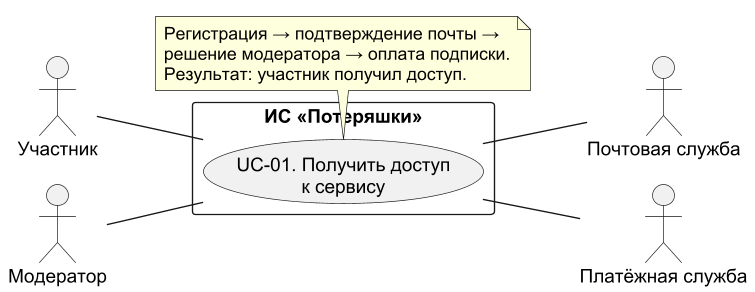
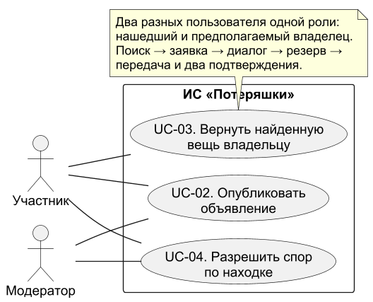
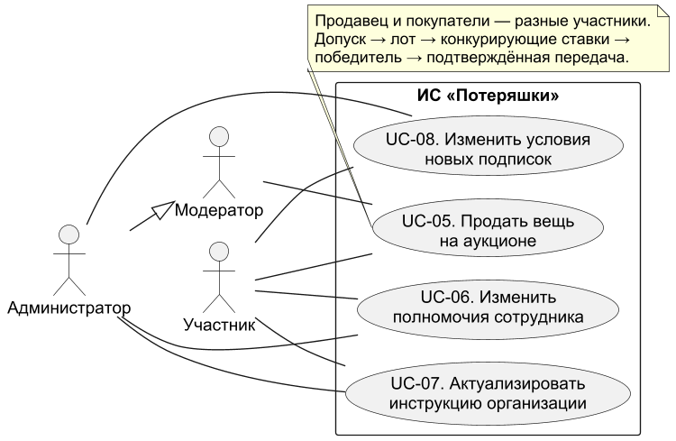
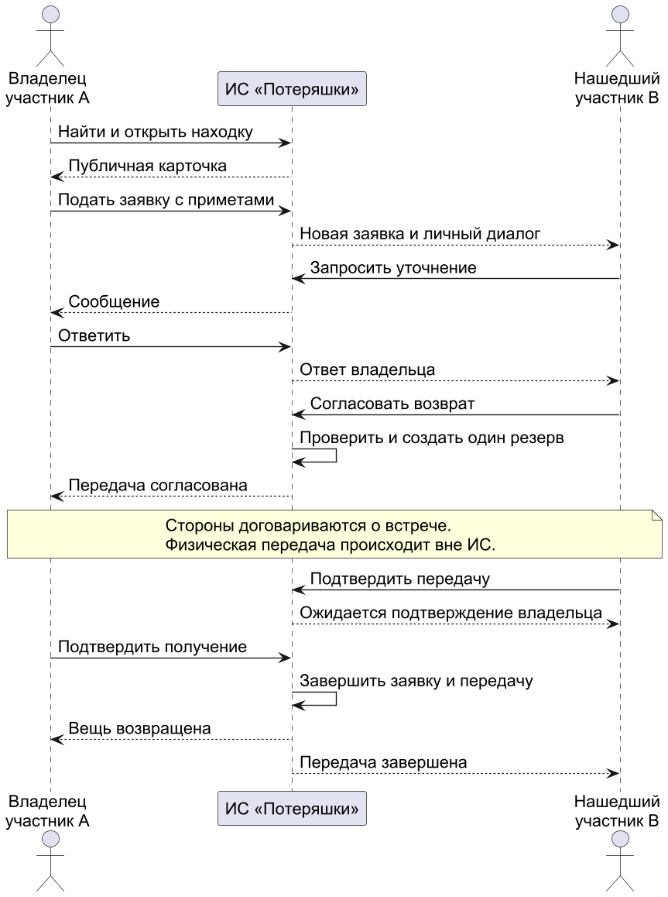
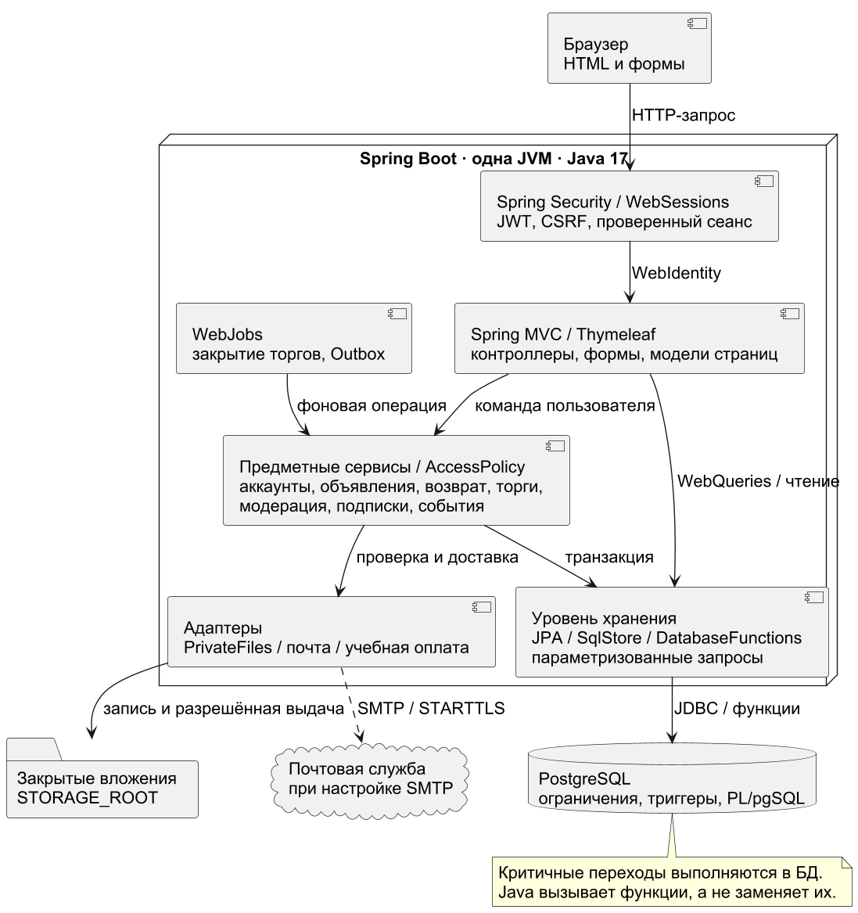
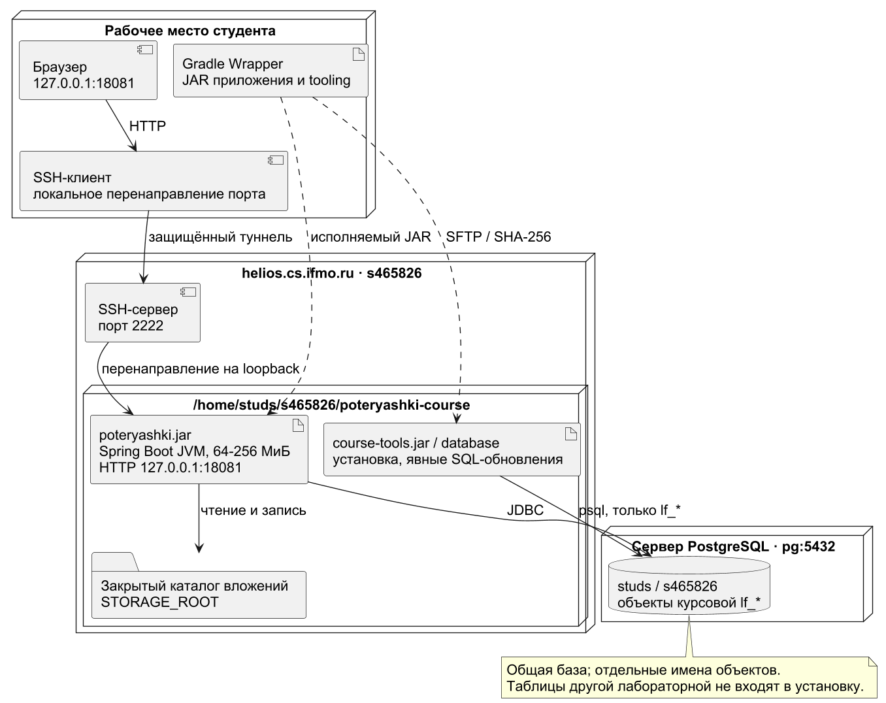

# Информационная система «Потеряшки»

Отчёт по первому этапу курсовой работы: анализ предметной области и проектирование системы.

## Задание

Первый этап курсовой работы включает:

1. Выбор предметной области информационной системы.
2. Подробное текстовое описание предметной области.
3. Обоснование назначения системы и решаемых задач.
4. Формулирование функциональных и нефункциональных требований.
5. Построение моделей основных прецедентов и описание их сценариев.
6. Выбор архитектуры, технологий и фреймворков с учётом демонстрации на helios.
7. Подготовку отчёта.

## 1. Предметная область

Предметная область — поиск и возврат потерянных вещей в городской среде. Разрабатываемая информационная система «Потеряшки» предназначена для публикации объявлений о потерянных и найденных предметах с указанием места и времени события, поиска совпадений, проверки заявителей и фиксации возврата. Дополнительно предусматриваются справочная интеграция с Петербургским метрополитеном, доступ к пользовательским функциям по подписке и аукционы вещей, которыми продавец вправе распоряжаться.

В качестве начального региона выбран Санкт-Петербург. Приложение проектируется как адаптивное веб-приложение. Подписка предоставляет доступ к пользовательским операциям после верификации учётной записи. Регистрация, оплата, восстановление доступа и официальные инструкции доступны до активации подписки. Цена задаётся администратором; конкретная стоимость не является требованием этапа 1. Базовый расчётный период подписки — 30 суток без автоматического списания.

Для демонстрации оплаты используется тестовый платёжный адаптер. Проверка пользователя включает подтверждение электронной почты и рассмотрение профиля модератором. Паспортные данные при регистрации не запрашиваются. После безуспешного поиска владельца пользователь может подать заявку на аукцион; возможность продажи зависит от основания распоряжения вещью и решения по заявке.

## 2. Подробное описание предметной области

### 2.1. Участники и их интересы

Владелец потерянной вещи стремится быстро найти предмет и подтвердить своё право на его получение. Нашедший стремится сообщить о находке, передать её надлежащему получателю и избежать многократных необоснованных обращений. Один пользователь может выступать в обеих ролях в разных ситуациях. Покупатель участвует в аукционе; продавцом становится пользователь, право распоряжения вещью которого проверено.

Постоянные роли доступа — участник, модератор и администратор. Нашедший, владелец, продавец и покупатель обозначают положение участника в конкретном процессе. Модератор проверяет учётные записи, объявления, жалобы и документы для допуска аукционов. Администратор управляет полномочиями сотрудников, тарифами, справочником организаций и аудитом. Физическое хранение и выдачу вещей могут осуществлять пользователи либо сторонние организации: метрополитен, городское бюро находок, полиция. Эти организации не считаются зарегистрированными партнёрами без отдельной договорённости.

Платёжный сервис подтверждает результаты оплаты подписки. Пользователь обращается к нему через платёжную форму. Почтовый сервис доставляет ссылки подтверждения и восстановления доступа. В самой системе уведомления сохраняются независимо от успешности доставки письма.

### 2.2. Существующий процесс и проблемы

Сведения о находках обычно распределены между объявлениями в социальных сетях, локальными чатами, бюро находок и транспортными организациями. Объявления оформляются неодинаково: часто отсутствуют время, точное место, категория или актуальный статус. Потерявшему приходится повторять поиск на нескольких площадках и связываться с авторами уже неактуальных сообщений.

Нашедший не всегда знает порядок передачи вещи и нужную организацию. Публикация полной фотографии документов или всех отличительных признаков увеличивает вероятность злоупотреблений. Несколько претендентов могут одновременно заявить права на один предмет. Отсутствие истории решений затрудняет разбор споров, а свободная публикация без проверки повышает долю рекламы, ложных находок и повторяющихся сообщений.

Подписка повышает стоимость массового злоупотребления и поддерживает работу сервиса, но сама по себе не гарантирует добросовестность. Поэтому в проекте она дополняется верификацией профиля, предварительной модерацией, ограничением частоты действий и механизмом жалоб. Сроки подписки и судьба уже опубликованной находки управляются раздельно.

### 2.3. Процесс работы с потерянными и найденными вещами

Пользователь регистрируется, подтверждает почту, проходит проверку профиля и активирует подписку. Затем он создаёт объявление типа «Потерял» или «Нашёл». Для находки фиксируются предмет, категория, описание, место, дата и время обнаружения, текущее место хранения. Для потери допускается временной интервал и приблизительный район, поскольку точный момент может быть неизвестен.

Часть признаков является публичной: категория, цвет, общее описание, район, дата, безопасная фотография. Контрольные признаки — например, содержимое сумки или индивидуальная отметка — видны только автору и уполномоченному модератору. Контактные сведения и точный адрес хранения не публикуются в общем каталоге.

Объявление проходит модерацию. После публикации пользователи ищут предметы по типу объявления, категории, месту и времени. Система предлагает кандидатов на совпадение по структурированным полям. Совпадение не считается доказательством принадлежности: пользователь направляет заявку и описывает скрытые признаки. Автор находки рассматривает заявку, может запросить уточнения и согласовать передачу через внутренний диалог.

После согласования система резервирует находку за одним претендентом. Фактическая передача происходит вне приложения, затем обе стороны подтверждают её. До второго подтверждения вещь имеет статус «Передача ожидает подтверждения»; при споре дело передаётся модератору. Если предмет хранится у организации, система показывает её порядок выдачи; самостоятельное подтверждение в приложении не заменяет решения организации.

### 2.4. Находки в метрополитене

Для места типа «Метро» указываются город, станция и при наличии линия или участок поездки. В карточке показываются официальные инструкции: справочная Петербургского метрополитена 8-800-350-11-55; вещи передаются дежурному по станции и находятся в метро 10 дней, затем передаются в городской Центр утерянных документов и средств связи по адресу: ул. Большая Монетная, д. 16, офис-центр № 1. Для получения вещи требуется паспорт и заявление. Эти сведения взяты с официальной страницы метрополитена [1].

Найденную в метро вещь пользователь передаёт сотруднику станции и может опубликовать информационное объявление с указанием организации хранения. Приложение предлагает уточнить актуальные условия по официальному контакту. Десятидневный срок не используется как срок допуска к аукциону. Данные справочника содержат ссылку на источник, дату проверки и дату следующего пересмотра; администратор проверяет их не реже одного раза в 30 дней.

Интеграция с метрополитеном реализуется через справочник организаций: приложение подбирает контакты и инструкцию по выбранному месту. Пользователь обращается в организацию по указанному телефону или через официальный сайт. Прямой обмен сведениями о находках может быть добавлен при наличии доступного программного интерфейса и договорённости с метрополитеном.

### 2.5. Условия аукциона

Обычная находка не становится товаром только потому, что на объявление долго нет откликов. Статья 227 ГК РФ предусматривает уведомление известного владельца; находку в помещении или транспорте передают представителю владельца помещения или транспорта. Когда надлежащий получатель неизвестен, предусмотрено заявление в полицию либо орган местного самоуправления [3]. Публикация в «Потеряшках» не заменяет такого заявления.

Для обычной находки статья 228 ГК РФ связывает приобретение собственности с отсутствием установленного или заявившегося правообладателя в течение шести месяцев после заявления о находке в компетентный орган. При отказе нашедшего приобрести вещь она поступает в муниципальную собственность [4]. Поэтому проект использует дату официального заявления и проверку подтверждающих материалов, а не дату публикации объявления.

Продавец подаёт заявку на допуск вещи к аукциону, указывает основание распоряжения и прикладывает подтверждение обращения и права. Модератор проверяет комплектность, отсутствие открытого спора и принадлежность допустимой категории; сомнительное основание ведёт к отказу. Автоматически подтверждается только комплектность данных, решение о допуске принимает модератор. Вещи, переданные метро или иной организации, обычный пользователь на аукцион не выставляет.

Из аукционного каталога исключаются документы, банковские карты, предметы с персональными данными, опасные и запрещённые предметы, а также вещи с неразрешёнными заявлениями владельцев. Для электронных устройств требуется подтверждение законного распоряжения и удаления пользовательских данных. Частные случаи продажи скоропортящихся вещей не включены в учебный процесс.

Аукцион проводится на повышение: задаются стартовая цена, шаг и время начала и окончания. Продавец не может делать ставки на собственный лот. Победителем становится автор наибольшей принятой ставки до срока окончания. Отсутствие ставок означает завершение без победителя. Расчёты за лот и доставку стороны организуют самостоятельно; система фиксирует договорённость и подтверждение передачи.

### 2.6. Основные информационные объекты

| Объект | Основные сведения | Назначение |
| --- | --- | --- |
| Пользователь | ID, имя, email, хеш пароля, набор ролей, статус проверки и блокировки, версия токенов | Учёт участника и управление доступом |
| Токен обновления | Пользователь, хеш токена, срок действия, отметка отзыва | Обновление доступа и завершение авторизации |
| Верификация | Пользователь, дата подачи, решение, причина, модератор | История рассмотрения профиля |
| Подписка | Пользователь, начало и окончание, статус, оплаченный тариф | Проверка права доступа |
| Платёж | ID операции, сумма, статус, внешний идентификатор | Связь оплаты с подпиской |
| Объявление | Тип, автор, категория, описание, время, место, статус | Учёт потери или находки |
| Фотография | Объявление, ключ файла, MIME, размер, доступность | Безопасная иллюстрация предмета |
| Контрольный признак | Объявление, закрытое описание | Проверка претендента |
| Место | Город, тип, район/адрес, станция, координаты при наличии | Поиск и подбор организации |
| Организация | Название, контакты, инструкция, URL источника, даты проверки | Справочная интеграция |
| Заявка на возврат | Находка, претендент, доказательства, статус | Рассмотрение права на получение |
| Диалог и сообщение | Участники, заявка, текст, время | Согласование возврата |
| Передача | Находка или лот, стороны, подтверждения, дата | Завершение жизненного цикла |
| Жалоба | Автор, объект, причина, решение | Контроль качества и спорные ситуации |
| Допуск к аукциону | Находка, основание, документы, решение | Контроль возможности продажи |
| Аукцион и ставка | Лот, продавец, цены, сроки, участник, серверное время | Организация торгов |
| Уведомление и аудит | Получатель/исполнитель, событие, время, результат | Информирование и прослеживаемость |

Это концептуальный состав данных. Логическая и физическая схемы PostgreSQL разрабатываются на следующем этапе.

### 2.7. Статусы и бизнес-правила

Объявление проходит состояния «Черновик → На модерации → Опубликовано». Из модерации возможны «Отклонено» или «На исправлении»; изменённое объявление проходит повторную проверку. Опубликованная находка может перейти в «Зарезервировано → Передача ожидает подтверждения → Возвращено». Отмена согласования возвращает её в опубликованное состояние. Автор может закрыть поиск; модератор — скрыть нарушающее правила объявление. Закрытая находка сохраняется в истории и не участвует в выдаче активных результатов.

У аукциона состояния «Черновик → На проверке → Допущен → Запланирован → Активен → Завершён с победителем / Завершён без ставок». Дополнительно предусмотрены «Отказано», «Приостановлен», «Отменён», «Передан покупателю». Неурегулированная претензия блокирует запуск и новые ставки; модератор определяет дальнейшее решение, оно сохраняется в аудите.

- BR-01. Публикация, поиск каталога, заявки, сообщения и ставки доступны проверенному, незаблокированному пользователю с активной подпиской. Сотрудники работают по служебным ролям без платной подписки.
- BR-02. До подписки разрешены регистрация, подтверждение почты, проверка профиля, покупка или продление подписки, восстановление доступа, просмотр собственных статусов и официальных контактов.
- BR-03. После истечения подписки новые пользовательские операции закрываются; ранее опубликованные объявления остаются видимыми. Участник может прочитать существующий диалог, подтвердить уже согласованную передачу, закрыть своё объявление и направить жалобу по своему делу без продления.
- BR-04. Проверка профиля не подтверждает принадлежность конкретной вещи. Каждая заявка на возврат рассматривается отдельно. Оплата не отменяет модерацию.
- BR-05. Для находки обязательны место и дата/время. Для потери допускается интервал; его начало не позже конца. Время события не может находиться в будущем. Ввод и отображение выполняются в часовом поясе Санкт-Петербурга Europe/Moscow; хранение и сравнение — как момент времени UTC.
- BR-06. Для метро обязательна станция либо описание участка поездки. Приложение не обещает наличие вещи в реестре организации.
- BR-07. У находки может быть несколько заявок, но не более одного действующего резервирования. Автор не направляет заявку на собственную находку.
- BR-08. Возврат закрывается после двух подтверждений или мотивированного решения модератора. Скрытые признаки и материалы спора не входят в публичный каталог.
- BR-09. Продление оплаченной подписки добавляет 30 суток от более позднего значения: текущего момента или окончания действующей подписки. Повторное платёжное событие не добавляет срок повторно.
- BR-10. Блокировка запрещает действия независимо от подписки. Принятые до истечения подписки ставки сохраняются; блокировка участника активного аукциона приостанавливает его до решения модератора.
- BR-11. Аукцион возможен только после отдельного допуска. Отсчёт шести месяцев по обычной находке ведётся от официального заявления; истечение срока лишь позволяет подать заявку на проверку и не создаёт допуск автоматически.
- BR-12. Ставка принимается при активном аукционе и серверном времени строго раньше окончания. Минимальная ставка — стартовая цена при отсутствии ставок, иначе последняя принятая цена плюс шаг. Денежные суммы хранятся точно, без float.
- BR-13. Одновременные ставки обрабатываются последовательно в транзакции для одного лота. При одинаковом предложении принимается только первая допустимая ставка; второй запрос получает актуальную минимальную цену.
- BR-14. Уведомление о похожем объявлении — рекомендация для проверки. Передача вещи и возникновение права собственности не следуют из алгоритма поиска.
- BR-15. Одна находка не может одновременно участвовать в возврате и продаже. После допуска и планирования аукциона обычное резервирование блокируется, а новые заявления владельцев поступают модератору и приостанавливают торги. На одну находку допускается только один незавершённый аукцион. Возврат возможен после отмены продажи и рассмотрения заявления.

## 3. Назначение системы и решаемые задачи

Цель системы — создать единое управляемое пространство поиска и возврата вещей, в котором сведения структурированы, участники проверены, а действия прослеживаются. Система должна сокращать количество площадок, которые просматривает пользователь, и помогать выбирать правильный маршрут обращения.

Система решает следующие задачи:

1. Собирать объявления о потерях и находках в едином каталоге со стандартными полями места, времени и предмета.
2. Давать поиск и подбор потенциально связанных объявлений без раскрытия контрольных признаков.
3. Обеспечивать доступ по подписке, проверку профилей, модерацию публикаций и рассмотрение жалоб.
4. Сопровождать заявку на возврат, общение сторон, резервирование и подтверждение фактической передачи.
5. Показывать проверенные контакты и порядок действий для находок в метрополитене.
6. Поддерживать контролируемый аукцион вещей с подтверждённым основанием распоряжения.
7. Сохранять историю изменений, платежей, ставок и решений для разрешения спорных ситуаций.

Результативность системы оценивается по числу подтверждённых возвратов, времени от публикации до первого обоснованного отклика, доле отклонённых нарушающих правила объявлений и сроку обработки модерации. Технические критерии приёмки определены в разделе 4.

## 4. Требования к информационной системе

### 4.1. Функциональные требования

Функциональные требования определяют действия системы и наблюдаемый результат для участника или сотрудника. Требования к скорости, защите, надёжности и условиям запуска выделены в раздел 4.2. Обозначение «Обязательно» означает включение в учебную реализацию; «Дополнительно» — развитие после основного набора. Внешняя оплата подписки заменяется учебным адаптером, прямой API организаций в демонстрацию не входит.

| ID | Требование | Проверяемый результат | Приоритет |
| --- | --- | --- | --- |
| FR-01 | Регистрация по уникальному email, подтверждение почты, вход, выход и восстановление доступа | Неподтверждённая почта не даёт пройти проверку; ссылка одноразовая; после выхода refresh-токен отозван, при смене пароля прежние токены аннулированы | Обязательно |
| FR-02 | Проверка профиля модератором с причиной решения | Пока проверка не одобрена, покупка подписки и функции каталога закрыты | Обязательно |
| FR-03 | Покупка и продление подписки; учёт успешных, неуспешных и повторных событий | Только подтверждённая оплата меняет срок; повторный callback не дублирует продление | Обязательно |
| FR-04 | Разграничение действий участника, модератора и администратора с учётом профиля, подписки и принадлежности дела | Чужой диалог и служебное действие недоступны; собственный кабинет до оплаты и завершение согласованной передачи после её истечения доступны по BR-02/03 | Обязательно |
| FR-05 | Создание и редактирование объявлений «Потерял» и «Нашёл» | Без категории, описания, места и времени отправка на модерацию невозможна | Обязательно |
| FR-06 | Загрузка до пяти JPEG/PNG, каждая до 5 МБ, и запись закрытых признаков | Неверный формат отклонён; закрытые поля отсутствуют в ответах каталога | Обязательно |
| FR-07 | Предварительная и повторная модерация объявлений | Черновик, отклонённое и непроверенное изменение не отображаются в каталоге | Обязательно |
| FR-08 | Поиск потерь и находок по тексту, категории, месту, времени, типу и публичному статусу | Фильтры применяются совместно; до 20 карточек на странице; переход сохраняет условия, черновики и скрытые материалы не выдаются | Обязательно |
| FR-09 | Подбор возможных совпадений потери и находки | Показываются до 10 кандидатов и причины подбора; принадлежность не подтверждается автоматически | Дополнительно |
| FR-10 | Справочник метро, контакты и инструкции по выбранному месту | Для Петербургского метро показаны официальный контакт, ссылка и дата проверки; справочник доступен без подписки | Обязательно |
| FR-11 | Заявки на возврат, скрытые доказательства, запрос уточнений, решение автора | Нельзя заявиться на своё объявление; повторная активная заявка того же пользователя отклоняется | Обязательно |
| FR-12 | Диалог сторон в рамках заявки | Чтение и отправка доступны только сторонам и модератору при разборе дела; общие контакты не раскрываются | Обязательно |
| FR-13 | Согласование передачи одной вещи одному получателю и фиксация подтверждений сторон | Создано одно действующее дело; первое подтверждение оставляет передачу открытой, второе завершает её; после первого подтверждения отмена направляется на разбор | Обязательно |
| FR-14 | Внутренние уведомления о решениях, сообщениях, окончании подписки и торгов | Событие доступно в кабинете; письмо не требуется для сохранения события | Обязательно |
| FR-15 | Жалобы на объявления, действия и спорные передачи | Жалоба получает статус и мотивированное решение; автор видит ход своего дела | Обязательно |
| FR-16 | Рассмотрение основания распоряжения вещью и допуск аукциона | Без проверенных материалов, при открытом споре или действующем возврате запуск невозможен | Обязательно |
| FR-17 | Создание лота с ценой, шагом, сроками; приём ставок и определение победителя | Самостоятельные ставки продавца, просроченные и недостаточные ставки отклоняются | Обязательно |
| FR-18 | Приостановка/отмена аукциона, завершение без ставок, подтверждение передачи покупателю | История ставок сохраняется; приостановленный лот не принимает ставки | Обязательно |
| FR-19 | Назначение служебных полномочий, изменение тарифов и инструкций организаций администратором | Назначаются только предусмотренные роли; последний администратор защищён; новая цена действует для новых заказов; инструкция содержит источник и дату проверки | Обязательно |
| FR-20 | Журнал решений и существенных изменений | Запись содержит исполнителя, время, объект, действие и результат; обычный пользователь не изменяет аудит | Обязательно |

### 4.2. Нефункциональные требования

Нефункциональные требования задают измеримые условия работы приложения. Нагрузочные показатели проверяются на helios с одной JVM и PostgreSQL, после прогрева и с учебными адаптерами оплаты и почты. Значения NFR-01/02 и RPO/RTO являются проектными целями; результаты измерений и восстановления фиксируются отдельно после реализации. Поведение операций определяется функциональными требованиями, а устойчивость при одновременных запросах — NFR-03.

| ID | Требование | Критерий проверки |
| --- | --- | --- |
| NFR-01 | Производительность основного поиска | При 10 000 объявлениях и 20 одновременных пользователях 95% запросов каталога завершаются за ≤ 2 с; измерение 5 минут после прогрева |
| NFR-02 | Скорость фиксации операций | 95% запросов публикации заявки и ставки выполняются за ≤ 2 с при той же нагрузке, без учёта загрузки файлов и внешних сервисов |
| NFR-03 | Целостность конкурентных действий | Два соединения одновременно резервируют одну находку: принят один запрос. Две одинаковые ставки: принята одна допустимая ставка. Повтор оплаты создаёт один период; завершение торгов не допускает ставку после срока |
| NFR-04 | Контроль доступа и защита токенов | Spring Security проверяет JWT, роль и состояние пользователя для каждой операции; пароли хешируются BCrypt; refresh-токен передаётся в Cookie HttpOnly и SameSite, в HTTPS-режиме Secure; операции с Cookie защищаются от CSRF |
| NFR-05 | Приватность | Контрольные признаки, личные контакты и документы допуска не доступны чужим пользователям через страницы, файловые URL или ответы контроллеров |
| NFR-06 | Безопасная обработка ввода | HTML пользователя экранируется; доступ к БД параметризован; формат, размер и содержимое изображения проверяются; EXIF удаляется; SVG и исполняемые файлы не принимаются |
| NFR-07 | Ограничение злоупотреблений | Не более 5 ошибочных попыток входа на учётную запись за 15 минут; не более 10 новых объявлений в сутки и 30 сообщений в минуту на пользователя; превышение даёт контролируемый отказ |
| NFR-08 | Надёжность оплаты и уведомлений | Повтор успешного события не добавляет срок подписки второй раз; сбой доставки не откатывает бизнес-операцию; повтор обработки одного события не создаёт второе внутреннее уведомление |
| NFR-09 | Восстановление после сбоя | Для учебной установки ежедневная копия БД и вложений, хранение 7 суток; целевые RPO ≤ 24 ч, RTO ≤ 2 ч; проверяется пробным восстановлением |
| NFR-10 | Удобство использования | Формы и сообщения на русском; ошибка ввода сохраняет корректные поля и указывает причину; подготовка черновика с одной фотографией занимает до 5 минут без учёта ожидания модерации |
| NFR-11 | Совместимость интерфейса | Формы и каталог работают при ширине 360–1920 px; проверяются актуальные стабильные Chrome, Firefox и Edge на момент приёмки |
| NFR-12 | Переносимость | Сборка через Gradle Wrapper на JDK 17 или новее; JAR со всеми шаблонами запускается на helios обычным пользователем; адрес PostgreSQL, порт и каталог файлов задаются конфигурацией |
| NFR-13 | Наблюдаемость | Логи содержат ID запроса и ошибки; в них нет паролей, платёжных секретов, контрольных признаков и полных доказательств; аудит доступен только служебным ролям |
| NFR-14 | Проверяемость и сопровождение | Предметные сервисы отделены от контроллеров; SQL-изменения версионируются в Git и применяются явно; учебные адаптеры отделены; интеграционные проверки используют временные объекты PostgreSQL |
| NFR-15 | Актуальность справочных данных | У каждой инструкции есть официальный URL и дата проверки; после 30 суток появляется признак необходимости обновления; недоступность внешнего сайта не ломает карточку |
| NFR-16 | Изоляция и хранение данных | Учебные пользователи и платежи синтетические; временные проверки не изменяют исходные объекты и последовательности общей базы; вложения хранятся в отдельном закрытом каталоге; сроки хранения реальных данных задаются до эксплуатации |

### 4.3. Границы реализации

В обязательный объём входят аккаунты, модерация, учебная оплата подписки, каталог, заявки, внутренние сообщения, возврат, справочник метро, контролируемые аукционы, уведомления и аудит. Нативные мобильные приложения, распознавание вещей по фотографии, геокодирование внешними сервисами, курьерская доставка, денежные расчёты за лоты и интеграция с реестрами метро не включены. Карта и отдельный процесс удаления и обезличивания профиля относятся к дальнейшему развитию. В базовой версии место выбирается из справочника и описывается текстом.

## 5. Модели и описания основных прецедентов

### 5.1. Роли и границы прецедентов

В системе выделены три роли доступа. Роль определяет набор разрешённых операций; состояние профиля и срок подписки проверяются отдельно.

| Роль | Ответственность |
| --- | --- |
| Участник | Получает доступ к сервису, публикует объявления, ищет вещи, согласовывает передачу и участвует в торгах. До проверки профиля и оплаты доступны регистрация, собственный кабинет и справочная информация. |
| Модератор | Проверяет профили, объявления и основания продажи, рассматривает жалобы и принимает решения по спорным передачам. Не рассматривает собственные материалы. |
| Администратор | Назначает служебные полномочия, меняет тарифы и справочник организаций, контролирует историю служебных действий. Может выполнять операции модератора. |

Владелец вещи, нашедший, продавец и покупатель — обозначения участников конкретного процесса. Отдельные роли доступа для них не создаются. В UC-03 взаимодействуют две учётные записи участников: автор находки и её предполагаемый владелец. В UC-05 продавец и покупатели также имеют роль «Участник», но выполняют разные действия в одном процессе.

Почтовая и платёжная службы являются внешними техническими актёрами, а не ролями пользователей. Метрополитен служит источником справочных сведений: в выбранном варианте интеграции его сотрудники не работают в приложении. Планировщик является внутренним компонентом системы.

Каждый прецедент описывает одну цель и законченный результат. Регистрация, проверка профиля и первая оплата составляют процесс получения доступа; подготовка и модерация объявления — процесс его публикации; поиск, заявка, диалог и два подтверждения — процесс возврата. Нажатия кнопок, проверка подписки и сохранение записи являются шагами этих процессов. Вход служит предусловием защищённых действий.

| ID | Цель прецедента | Основные участники | Результат успешного завершения |
| --- | --- | --- | --- |
| UC-01 | Получить доступ к сервису | Участник, модератор; почтовая и платёжная службы | Проверенный участник имеет действующую подписку |
| UC-02 | Опубликовать объявление | Участник — автор, модератор | Проверенное объявление доступно в каталоге |
| UC-03 | Вернуть найденную вещь владельцу | Два участника: нашедший и владелец | Передача подтверждена обеими сторонами |
| UC-04 | Разрешить спор по находке | Заявитель, другая сторона, модератор | Сохранены решение и допустимое состояние дела |
| UC-05 | Продать вещь на аукционе | Продавец, покупатели, модератор | Победитель определён, передача подтверждена |
| UC-06 | Изменить полномочия сотрудника | Администратор, участник — сотрудник | Служебный доступ соответствует назначенным ролям |
| UC-07 | Актуализировать инструкцию организации | Администратор, участник — читатель | Пользователь получает обновлённые контакты и инструкцию |
| UC-08 | Изменить условия новых подписок | Администратор, участник — плательщик | Новые заказы используют новый тариф; старые условия сохранены |

Сплошная линия UML связывает актёра с прецедентом. Обобщение администратора и модератора показывает наследование служебных возможностей. Один актёр «Участник» может представлять несколько разных учётных записей внутри сценария. Последовательность их действий показана в описаниях и на диаграмме взаимодействия возврата.







### 5.2. UC-01. Получить доступ к сервису

| Поле | Описание |
| --- | --- |
| Цель | Получить проверенную учётную запись и оплаченный доступ к каталогу и пользовательским операциям. |
| Инициатор | Участник, впервые обращающийся к сервису. |
| Другие участники | Модератор, почтовая служба, платёжная служба. |
| Предусловия | Регистрация открыта; существует действующий тариф. Модератор имеет служебный доступ. |
| Триггер | Участник начинает регистрацию. |
| Постусловия | Почта подтверждена, профиль одобрен, подписка активна. Сохранены решения, заказ и результат оплаты. |
| Требования | FR-01–04, FR-14, FR-20; NFR-04, NFR-07, NFR-08. |

| Шаг | Исполнитель | Действие и реакция системы |
| --- | --- | --- |
| 1 | Участник | Вводит имя, email и пароль. Система проверяет поля и уникальность адреса. |
| 2 | Система, почтовая служба | Создаёт неподтверждённую запись, сохраняет хеш пароля и отправляет одноразовую ссылку. |
| 3 | Участник | Открывает ссылку. Система проверяет срок и отмечает подтверждение почты. |
| 4 | Участник | Подаёт профиль на проверку и видит состояние «Ожидает рассмотрения». |
| 5 | Модератор | Открывает очередь, изучает данные профиля и принимает мотивированное решение. |
| 6 | Система | Сохраняет одобрение и уведомляет участника. До одобрения доступ к каталогу остаётся закрытым. |
| 7 | Участник | Выбирает тариф. Система создаёт заказ с зафиксированной ценой и длительностью. |
| 8 | Участник, платёжная служба | Выполняют оплату. В учебном режиме результат формирует тестовый адаптер без списания средств. |
| 9 | Система | Проверяет заказ и событие оплаты, активирует подписку одной транзакцией и сохраняет уведомление. |
| 10 | Участник | Открывает каталог. Система проверяет текущие роли, профиль, блокировку и оплаченный период и предоставляет доступ. |

Альтернативные и ошибочные потоки:

- A1. Адрес уже зарегистрирован: участник входит в существующую запись; при утрате пароля использует одноразовую ссылку восстановления. Проверка профиля повторно не требуется, если ранее одобренный профиль сохраняет действующий статус.
- A2. Ссылка просрочена либо использована: подтверждение отклоняется, участник запрашивает новую ссылку. Ошибка почтовой доставки сохраняет неподтверждённую запись.
- A3. Модератор отклоняет профиль: участник получает причину, исправляет данные и возвращается к шагу 4. Оплата и каталог до одобрения недоступны.
- A4. Оплата отменена или отклонена: заказ сохраняет результат, оплаченный доступ не открывается. Повтор успешного события не добавляет срок второй раз.
- A5. У проверенного участника закончилась подписка: он выполняет шаги 7–10; продление начинается от более позднего из текущего момента и конца действующего периода.

### 5.3. UC-02. Опубликовать объявление

| Поле | Описание |
| --- | --- |
| Цель | Разместить в каталоге проверенное сообщение о потере или находке. |
| Инициатор | Участник — автор объявления. |
| Другие участники | Независимый модератор; другие участники просматривают опубликованный результат. |
| Предусловия | Автор вошёл, профиль одобрен, подписка активна; аккаунт не заблокирован. |
| Триггер | Автор создаёт новое объявление. |
| Постусловия | Объявление опубликовано; закрытые признаки и документы отсутствуют в публичной карточке. Решение модератора сохранено. |
| Требования | FR-04–07, FR-14, FR-20; NFR-05–07, NFR-10. |

| Шаг | Исполнитель | Действие и реакция системы |
| --- | --- | --- |
| 1 | Автор | Выбирает тип «Потерял» или «Нашёл» и категорию предмета. |
| 2 | Автор | Указывает место, дату и время; для потери может задать интервал. Система проверяет заполнение и отсутствие будущего времени. |
| 3 | Автор | Вводит публичное описание и отдельно закрытые приметы. Для вещи у организации указывает хранителя. |
| 4 | Система | Сохраняет черновик, доступный автору. |
| 5 | Автор | Добавляет фотографии. Система проверяет формат, размер и содержимое, удаляет метаданные и связывает файлы с черновиком. |
| 6 | Автор | Отправляет объявление на проверку. Система помещает его в очередь модерации. |
| 7 | Модератор | Проверяет описание, место, время и изображения; исключает персональные данные, рекламу и сомнительные материалы. |
| 8 | Модератор | Одобряет публикацию. Система сохраняет исполнителя, дату и результат рассмотрения. |
| 9 | Система | Переводит объявление в опубликованное состояние и уведомляет автора. |
| 10 | Другой участник | Находит объявление в каталоге и получает публичную карточку без закрытых признаков и точного адреса хранения. |

Альтернативные и ошибочные потоки:

- A1. Поля или изображение не проходят проверку: черновик сохраняется, автор исправляет указанную ошибку.
- A2. Модератор отклоняет объявление с причиной: оно не появляется в каталоге; после правки автор повторяет шаги 6–9.
- A3. Автор существенно изменяет опубликованное объявление: оно проходит повторную модерацию. Изменение вещи, уже участвующей в передаче или торгах, ограничено правилами её состояния.
- A4. Модератор является автором материала: система запрещает рассмотрение, материал проверяет другой сотрудник.

### 5.4. UC-03. Вернуть найденную вещь владельцу

| Поле | Описание |
| --- | --- |
| Цель | Сопоставить находку с обращением владельца и зафиксировать фактическую передачу вещи. |
| Инициатор | Участник — предполагаемый владелец. |
| Другие участники | Участник — нашедший; при споре модератор участвует в UC-04. |
| Предусловия | Находка опубликована; претендент и автор — разные пользователи. Для поиска и новой заявки нужна действующая подписка. |
| Триггер | Владелец начинает поиск потерянного предмета. |
| Постусловия | Заявка исполнена, обе стороны подтвердили передачу, находка имеет статус «Возвращено». |
| Требования | FR-04, FR-08–14, FR-20; NFR-03–06, NFR-10. |

| Шаг | Исполнитель | Действие и реакция системы |
| --- | --- | --- |
| 1 | Владелец | Задаёт текст, категорию, место, время и публичный статус. Система выдаёт до 20 карточек и сохраняет условия перехода к следующей странице. |
| 2 | Владелец | Открывает подходящую находку и сравнивает публичные сведения с обстоятельствами потери. |
| 3 | Владелец | Подаёт заявку и описывает непубличные приметы. Система проверяет автора заявки и отсутствие повторной активной заявки. |
| 4 | Система | Создаёт дело и личный диалог, сохраняет доказательства и уведомляет нашедшего. |
| 5 | Нашедший | Изучает заявку, сопоставляет её с закрытыми признаками и задаёт уточняющий вопрос в диалоге. |
| 6 | Владелец | Отвечает. Система сохраняет сообщение и уведомляет другую сторону без раскрытия его текста в общем каталоге. |
| 7 | Нашедший | Согласовывает передачу этому претенденту. Система блокирует находку, повторно проверяет доступность и создаёт единственный резерв. |
| 8 | Владелец и нашедший | Договариваются в диалоге о времени и способе встречи. |
| 9 | Владелец и нашедший | Передают вещь при встрече. Физическая передача происходит вне приложения. |
| 10 | Нашедший | Подтверждает передачу. Система сохраняет первое подтверждение; дело остаётся незавершённым. |
| 11 | Владелец | Подтверждает получение. Система сохраняет второе подтверждение и завершает заявку и передачу одной транзакцией. |
| 12 | Обе стороны | Видят завершённое дело и уведомления; находка исключена из выдачи активных объявлений. |

Альтернативные и ошибочные потоки:

- A1. Совпадений нет: владелец меняет условия либо публикует сообщение о потере через UC-02. Автоматический подбор кандидатов является дополнительной функцией поиска.
- A2. Доказательства не совпадают: нашедший отклоняет заявку с объяснением либо продолжает уточнение. Вещь не резервируется автоматически по совпадению описания.
- A3. Другой претендент уже получил резерв: согласование отклоняется, сохраняется одно принятое дело.
- A4. До первого подтверждения встреча отменена: обычная заявка закрывается, резерв снимается. После подтверждения одной стороной разногласие передаётся на UC-04.
- A5. Подписка закончилась после согласования: чтение своего диалога, подтверждение передачи и жалоба по существующему делу доступны без новой оплаты.
- A6. Вещь находится в метро или у другой организации: система показывает контакт, источник, дату проверки и порядок обращения. Владелец связывается с хранителем вне приложения; выдачу определяет организация. Личное резервирование у автора информационного объявления не создаётся, а подтверждение в приложении не заменяет решение хранителя.



### 5.5. UC-04. Разрешить спор по находке

| Поле | Описание |
| --- | --- |
| Цель | Получить мотивированное решение по жалобе и согласовать дальнейшее состояние связанного дела. |
| Инициатор | Участник — заявитель жалобы. |
| Другие участники | Участник — другая сторона, независимый модератор. |
| Предусловия | Есть объявление, пользователь либо дело передачи, на которое направляется жалоба. По своему существующему делу жалоба доступна при истёкшей подписке. |
| Триггер | Заявитель обнаруживает нарушение или разногласие о передаче. |
| Постусловия | Жалоба закрыта с причиной решения; допустимые изменения дела и действия сотрудника сохранены в аудите. |
| Требования | FR-04, FR-12–15, FR-18, FR-20; NFR-04, NFR-05, NFR-13. |

| Шаг | Исполнитель | Действие и реакция системы |
| --- | --- | --- |
| 1 | Заявитель | Выбирает объект жалобы, описывает обстоятельства и отправляет обращение. |
| 2 | Система | Проверяет полномочия и объект, сохраняет жалобу со статусом ожидания. При открытом споре о лоте приостанавливает связанные торги. |
| 3 | Модератор | Открывает очередь и выбирает дело, в котором не является заинтересованной стороной. |
| 4 | Модератор | Читает материалы и связанный диалог при его наличии; доступ к чужому диалогу разрешён только на время открытого разбора. |
| 5 | Модератор | При необходимости запрашивает уточнение обстоятельств в доступном диалоге. |
| 6 | Заявитель и другая сторона | Представляют объяснения. Система сохраняет сообщения и историю дела. |
| 7 | Модератор | Оценивает материалы и выбирает решение с обязательным обоснованием. |
| 8 | Система | Применяет разрешённое действие: закрывает жалобу; при необходимости скрывает нарушение, блокирует доступ или завершает спорную передачу по служебному решению. |
| 9 | Система | Записывает решение в аудит и уведомляет заявителя. После закрытия жалобы служебный доступ к чужому диалогу прекращается. |
| 10 | Заявитель и другая сторона | Проверяют решение и состояние связанного объявления или передачи в своих кабинетах. |

Альтернативные и ошибочные потоки:

- A1. Материалов недостаточно: модератор запрашивает уточнения, дело остаётся открытым.
- A2. Нарушение не подтверждено: жалоба отклоняется с причиной, необоснованная блокировка не применяется.
- A3. Проверяющий участвует в споре: рассмотрение передаётся независимому сотруднику.
- A4. Вопрос требует компетентной организации: стороны получают официальный маршрут обращения. Система фиксирует информационное решение и не устанавливает право собственности.
- A5. Предлагаемое изменение противоречит состоянию передачи или торгов: система отклоняет его; история подтверждений и ставок сохраняется.

### 5.6. UC-05. Продать вещь на аукционе

| Поле | Описание |
| --- | --- |
| Цель | Продать допустимую вещь с проверенным основанием распоряжения и зафиксировать передачу победителю. |
| Инициатор | Участник — продавец. |
| Другие участники | Модератор и несколько участников — покупателей; один из них становится победителем. |
| Предусловия | Продавец допущен к сервису; покупатель имеет действующий доступ на момент ставки. Вещь относится к объявлению продавца, опубликована, не хранится у организации и не участвует в согласованном возврате. Основание распоряжения может быть подтверждено. |
| Триггер | Продавец подаёт материалы на допуск к продаже. |
| Постусловия | Торги завершены, победитель определён, создано единственное дело передачи; продавец и победитель подтвердили её завершение. |
| Требования | FR-04, FR-12–18, FR-20; NFR-03–06, NFR-08. |

| Шаг | Исполнитель | Действие и реакция системы |
| --- | --- | --- |
| 1 | Продавец | Указывает основание продажи и прикладывает подтверждающие материалы по правилам BR-11. |
| 2 | Система | Проверяет комплектность, допустимую категорию и отсутствие конфликтующего процесса, создаёт заявку на допуск. |
| 3 | Модератор | Проверяет материалы, даты, отсутствие заявлений владельца и принимает мотивированное решение о допуске. |
| 4 | Система | Сохраняет разрешение, сотрудника и дату решения и уведомляет продавца. |
| 5 | Продавец | Задаёт стартовую цену, шаг и сроки. Система связывает аукцион с разрешением именно на эту вещь. |
| 6 | Система | Открывает торги в установленное время. Покупатели видят условия лота и текущую цену. |
| 7 | Первый покупатель | Отправляет ставку. Система проверяет доступ, время и цену и принимает её в транзакции. |
| 8 | Другой покупатель | Повышает предложение. Система последовательно проверяет конкурирующие ставки одного лота и обновляет текущую цену. |
| 9 | Система | По окончании срока закрывает торги и фиксирует наибольшую принятую ставку и победителя. |
| 10 | Система | Создаёт для продавца и победителя одну заявку, диалог и передачу, уведомляет участников. |
| 11 | Продавец и победитель | Согласовывают встречу и расчёт в диалоге. Расчёт за сам лот и физическая передача происходят вне приложения. |
| 12 | Продавец | Подтверждает передачу вещи. Дело ожидает подтверждения победителя. |
| 13 | Победитель | Подтверждает получение. Система завершает передачу и сохраняет итог торгов и историю ставок. |

Альтернативные и ошибочные потоки:

- A1. Основание либо категория не подходят: модератор отклоняет допуск с причиной, аукцион не создаётся.
- A2. Продавец ставит на собственный лот, цена ниже минимальной или срок закончился: ставка отклоняется, принятые ранее ставки сохраняются.
- A3. Ставки приходят одновременно: после первой принятой ставки второй запрос проверяется относительно новой цены. Повтор с тем же ключом не создаёт дубль.
- A4. Ставок нет: аукцион завершается без победителя; дело передачи не создаётся, вещь остаётся доступной для дальнейшего поиска.
- A5. Появляется заявление владельца, жалоба или блокировка участника: торги приостанавливаются и передаются на разбор UC-04. Приостановленный аукцион новые ставки не принимает.
- A6. У победителя истекла подписка: результат принятой ставки сохраняется; участники завершают существующую передачу без продления. Односторонняя отмена результата торгов запрещена; спор рассматривает модератор.

### 5.7. UC-06. Изменить полномочия сотрудника

| Поле | Описание |
| --- | --- |
| Цель | Назначить или отозвать служебную роль конкретного пользователя. |
| Инициатор | Администратор. |
| Другие участники | Участник, которому назначается или отзывается роль модератора либо администратора. |
| Предусловия | Инициатор имеет действующие административные права; целевая запись существует. |
| Триггер | Возникает необходимость изменить состав сотрудников. |
| Постусловия | Назначения ролей изменены, причина и исполнитель сохранены. Новые запросы сотрудника проверяются по актуальным полномочиям. |
| Требования | FR-04, FR-19, FR-20; NFR-04, NFR-13. |

| Шаг | Исполнитель | Действие и реакция системы |
| --- | --- | --- |
| 1 | Администратор | Открывает пользователей и выбирает целевую запись. |
| 2 | Система | Показывает текущие назначения и состояние пользователя. |
| 3 | Администратор | Выбирает назначение либо отзыв одной служебной роли и указывает причину. |
| 4 | Система | Повторно проверяет права инициатора и защиту последнего действующего администратора. |
| 5 | Система | Сохраняет назначение и запись аудита в одной транзакции. |
| 6 | Сотрудник | Обращается к служебной странице. Система проверяет текущее назначение роли, включая случаи использования ранее выданного сеанса. |
| 7 | Администратор | Проверяет запись изменения в журнале служебных действий. |

Альтернативные потоки: повторное назначение не создаёт дубль; отзыв роли последнего администратора запрещён; запрос сотрудника без требуемой роли отклоняется независимо от состояния старого токена.

### 5.8. UC-07. Актуализировать инструкцию организации

| Поле | Описание |
| --- | --- |
| Цель | Обновить проверенные контакты и порядок обращения к хранителю найденной вещи. |
| Инициатор | Администратор. |
| Другие участники | Участник, которому требуется инструкция. Официальный сайт организации является источником данных. |
| Предусловия | Организация есть в справочнике; доступен официальный источник для проверки. |
| Триггер | Истекает срок пересмотра записи либо обнаружены изменившиеся сведения. |
| Постусловия | В справочнике сохранены проверенные сведения, источник и дата проверки; пользователю показывается новая редакция. |
| Требования | FR-10, FR-19, FR-20; NFR-15. |

| Шаг | Исполнитель | Действие и реакция системы |
| --- | --- | --- |
| 1 | Администратор | Находит запись, требующую проверки. Система показывает источник и дату последнего пересмотра. |
| 2 | Администратор | Сверяет телефон, адрес и инструкцию с официальным источником вне приложения. |
| 3 | Администратор | Вносит сведения и дату проверки, сохраняет ссылку на источник. |
| 4 | Система | Проверяет данные и полномочия, обновляет запись и сохраняет действие в аудите. |
| 5 | Участник | Открывает инструкцию метро либо карточку вещи у организации. |
| 6 | Система | Показывает актуальную запись, дату и официальный источник. Справочная страница доступна без подписки. |

Альтернативные потоки: источник недоступен — сведения не помечаются как заново проверенные, остаются прежняя дата и предупреждение; ошибочная ссылка или отсутствующие обязательные поля — обновление отклоняется. Пользователь может уточнить порядок выдачи по официальному телефону.

### 5.9. UC-08. Изменить условия новых подписок

| Поле | Описание |
| --- | --- |
| Цель | Ввести новый тариф, сохранив условия уже созданных заказов и оплаченных периодов. |
| Инициатор | Администратор. |
| Другие участники | Участник, оформляющий подписку; платёжная служба участвует в оплате через UC-01. |
| Предусловия | Администратор имеет доступ к тарифам. |
| Триггер | Принимается решение изменить стоимость или длительность новых подписок. |
| Постусловия | Новый тариф доступен для новых заказов; старые заказы и подписки сохраняют исходные параметры. Изменение записано в аудит. |
| Требования | FR-03, FR-19, FR-20; NFR-08. |

| Шаг | Исполнитель | Действие и реакция системы |
| --- | --- | --- |
| 1 | Администратор | Вводит название, цену и длительность нового тарифа. |
| 2 | Система | Проверяет допустимость сумм и срока, сохраняет новый тариф и аудит. |
| 3 | Администратор | Закрывает прежний тариф для новых заказов, если его использование прекращается. |
| 4 | Участник | Открывает доступные тарифы и выбирает новый вариант. |
| 5 | Система | Создаёт заказ со снимком цены и длительности выбранного тарифа. |
| 6 | Участник | Продолжает оформление через UC-01. Ранее созданный заказ при оплате использует сохранённые условия. |
| 7 | Администратор | Проверяет историю изменения; ранее оплаченные периоды продолжают действовать до своего окончания. |

Альтернативные потоки: цена или срок некорректны — тариф не сохраняется; закрытый тариф нельзя выбрать для нового заказа; повтор оплаты уже созданного заказа не увеличивает срок повторно.


## 6. Предлагаемая архитектура

### 6.1. Архитектурный подход и технологии

Система проектируется как модульное монолитное приложение на Java 17. Одна JVM принимает HTTP-запросы, формирует страницы и выполняет прикладные операции. PostgreSQL и файловое хранилище отделены от процесса приложения. Модули предметной области разделяют ответственность, но используют общие правила доступа и транзакции.

| Уровень | Технологии | Ответственность |
| --- | --- | --- |
| Представление | Spring MVC, Thymeleaf, HTML, CSS | Страницы, формы, валидация параметров, отображение результатов и ошибок |
| Аутентификация | Spring Security, JWT, BCrypt | Проверка сеанса, защита форм CSRF, вход, выход и обновление токенов |
| Бизнес-логика | Java-сервисы, AccessPolicy, Spring Transactions | Правила процессов, права на объекты, координация действий и транзакционные границы |
| Хранение | Hibernate/JPA, Spring Data JPA, JdbcTemplate | Проекции сущностей, параметризованные запросы, вызовы функций и процедур |
| База данных | PostgreSQL, PL/pgSQL | Связи, ограничения, триггеры, блокировки и критичные переходы состояний |
| Файловый адаптер | Закрытый локальный каталог, Java ImageIO | Проверка фотографий, хранение вложений и выдача после проверки прав |
| Внешние адаптеры | Учебная оплата; почтовый интерфейс и SMTP | Подтверждение оплаты подписки, отправка писем и замена интеграций для демонстрации |
| Сборка и проверка | Gradle Wrapper, JUnit, Spring Test, Java-модуль tooling | Сборка JAR, интеграционные проверки, диаграммы, отчёты и установка на helios |

Java, Spring Boot, Hibernate/JPA, PostgreSQL, Lombok и Gradle выбраны с учётом проекта MyFilmList [7]. Spring MVC и Thymeleaf позволяют включить контроллеры и представления в один JAR [8, 9]. Семейство Spring Boot 3.5 поддерживает выбранную версию Java [5]. Версии фиксируются в build.gradle. Изменения схемы представлены SQL-скриптами в Git; Hibernate проверяет соответствие сущностей существующей схеме и не создаёт таблицы при запуске.

На диаграмме компонентов показаны направления вызовов внутри приложения. Развёртывание, сетевые соединения и места хранения вынесены в отдельную схему.



### 6.2. Компоненты и распределение ответственности

| Компонент | Вход и результат | Основные зависимости |
| --- | --- | --- |
| WebSessions, WebIdentity, Spring Security | Проверенный сеанс и идентификатор действующего пользователя | Хеши паролей, версии токенов и отозванные сеансы в PostgreSQL |
| MVC-контроллеры | Параметры форм; модель страницы либо перенаправление | Сервисы предметной области и Thymeleaf |
| WebQueries | Проекции для каталога, кабинета и очередей | SqlStore и проверки доступа; публичные проекции исключают секреты |
| AccountService, SubscriptionService | Подтверждённый профиль, заказ и оплаченный период; UC-01 | AccessPolicy, почтовый и платёжный адаптеры, DatabaseFunctions |
| ListingService | Черновик, публикация, фильтры и карточка; UC-02 и начало UC-03 | AccessPolicy, SqlStore, поиск PL/pgSQL и файловый адаптер |
| ReturnService | Заявка, диалог, резерв и подтверждения; UC-03 | Проверка участников и функции резервирования и передачи |
| AdministrationService | Жалоба, служебное решение, роли, тарифы, организации; UC-04, UC-06–08 | AccessPolicy, SqlStore и неизменяемый аудит |
| AuctionService | Допуск, лот, ставка и итог; UC-05 | Функции торгов, запись находки и проверка права продавца |
| OutboxService, WebJobs | Доставка уведомлений и закрытие истёкших торгов | Очередь событий и процедура PostgreSQL; повторная обработка безопасна |
| SqlStore, репозитории JPA, DatabaseFunctions | Параметризованные операции хранения | JDBC-пул и схема PostgreSQL |
| PrivateFiles, MediaPages | Проверенный файл и разрешённая выдача | Закрытый каталог и проверка владельца либо служебных полномочий |

Роль инициатора определяется по проверенному сеансу. Контроллер не принимает идентификатор действующего пользователя из скрытого поля формы. AccessPolicy проверяет роль, состояние профиля, подписку и принадлежность объекта в серверном коде; скрытие кнопки не заменяет эту проверку. Для модератора отдельно проверяется отсутствие заинтересованности в рассматриваемом деле.

Модели Thymeleaf содержат только сведения, нужные странице. Пароли, хеши токенов и чужие закрытые признаки в них не включаются. Служебная очередь и публичный каталог используют разные проекции. Шаблоны находятся в src/main/resources/templates, стили — в src/main/resources/static и включаются в JAR.

### 6.3. Обработка запроса на примере возврата

1. Владелец открывает опубликованную находку. Spring Security проверяет токен и текущий сеанс; контроллер получает идентификатор пользователя через WebIdentity.
2. Контроллер передаёт заявку и доказательства в ReturnService. AccessPolicy проверяет доступ, сервис создаёт заявку и диалог в одной транзакции и сохраняет событие уведомления.
3. Нашедший открывает дело из своего кабинета. Проверка принадлежности даёт доступ только участникам заявки; во время открытого спора допускается независимый модератор.
4. После уточнений нашедший подтверждает согласование. DatabaseFunctions вызывает lf_reserve_found; функция блокирует находку, проверяет отсутствие другого резерва и создаёт передачу.
5. Первое подтверждение вызывает lf_confirm_transfer и сохраняет одну отметку. Второе завершает передачу, заявку и состояние находки той же функцией.
6. Контроллер возвращает обновлённую страницу. OutboxService доставляет уведомления после фиксации транзакции. Ошибка внешнего адаптера не отменяет уже сохранённый результат возврата.

Диаграмма взаимодействия UC-03 показывает разных пользователей одной роли и последовательность их обращений к приложению. Обмен HTTP-запросами идёт через контроллеры; пользователи не обращаются к базе напрямую.

### 6.4. Хранение и транзакционные границы

В PostgreSQL размещаются учётные записи, назначения ролей, токены, проверки профилей, тарифы и заказы, подписки, объявления, справочники, заявки, сообщения, передачи, жалобы, допуски, аукционы, ставки, уведомления, очередь событий и аудит. Таблица назначений ролей образует связь M:N между пользователями и ролями. Конкретные таблицы, атрибуты и ограничения разрабатываются на втором этапе.

Критичные операции реализуются функциями PL/pgSQL: активация подписки, поиск, резервирование, подтверждение передачи, приём ставки и завершение торгов. Третий этап должен вызывать эти функции из Java, сохраняя правила и блокировки в базе. Прикладной слой проверяет пользователя, подготавливает параметры и обрабатывает результат.

| Операция | Транзакционная граница | Защита от конфликта |
| --- | --- | --- |
| Оплата подписки | Событие оплаты и один оплаченный период | Ключ события, блокировки пользователя и заказа, отсутствие повторного продления |
| Согласование возврата | Принятая заявка, резерв, передача и событие | Блокировка находки, один действующий резерв и отсутствие незавершённых торгов |
| Подтверждение передачи | Отметка стороны либо завершение всего дела | Блокировка состояния дела и проверка участников |
| Приём ставки | Проверенная ставка и событие уведомления | Единый порядок блокировок: находка, затем аукцион; повторная проверка времени и цены |
| Завершение торгов | Победитель, итог и единственное дело передачи | Те же блокировки, запрет ставки после окончания, идемпотентный повтор |
| Служебное решение | Изменение состояния и аудит | Проверка независимости, полномочий и допустимого перехода |

Для денежных значений применяется NUMERIC(12,2), для моментов времени — timestamptz. Ввод и отображение используют Europe/Moscow. Поиск выполняется средствами PostgreSQL: индексы по месту, категории, типу и состоянию, полнотекстовый индекс по русскому описанию. Состав и полезность индексов обосновываются на втором этапе по прецедентам.

Outbox хранит событие вместе с бизнес-изменением в одной транзакции. Отдельный обработчик выбирает недоставленные записи, создаёт внутренние уведомления и отмечает доставку. Аудит фиксирует исполнителя, объект, действие, время и результат; пользовательские операции не редактируют журнал.

### 6.5. Файлы и внешние интеграции

Фотографии и подтверждающие материалы хранятся отдельно от статических ресурсов. В базе находятся ключ файла, тип, размер и связь с объявлением либо допуском. Фотография декодируется, проверяется и пересохраняется без исходных метаданных. Выдача файла идёт через контроллер с проверкой прав. Документ допуска доступен продавцу и модератору; публичный каталог его не раскрывает.

Для учебной установки выбран закрытый локальный каталог STORAGE_ROOT. MinIO может заменить файловый адаптер при дальнейшем развитии; такой вариант требует настройки закрытого бакета и совместного резервного копирования базы и объектов. Он не является зависимостью первоначального запуска на helios.

Платёжный адаптер подтверждает оплату подписки, а не расчёт между продавцом и покупателем лота. Учебный режим не списывает средства и проверяет повторные результаты. При подключении внешнего провайдера результат должен проверяться адаптером до вызова функции активации подписки.

Почтовый интерфейс используется для подтверждения адреса и восстановления доступа. В учебном режиме письма доступны получателю в его кабинете; для внешней доставки предусмотрены параметры SMTP и STARTTLS. Внутренние уведомления сохраняются в PostgreSQL независимо от почтовой доставки.

Справочная интеграция метро читает данные из справочника организаций. Администратор обновляет запись по официальному источнику через UC-07. Запрос к каталогу или инструкции не зависит от доступности сайта метрополитена; прямой обмен реестрами не предусматривается.

### 6.6. Развёртывание на helios



| Узел или ресурс | Размещение и доступ |
| --- | --- |
| Браузер | Рабочее место студента, http://127.0.0.1:18081 |
| SSH-туннель | Соединение с helios.cs.ifmo.ru:2222, перенаправление локального 18081 на loopback-порт приложения |
| Spring Boot JVM | ~/poteryashki-course, HTTP только на 127.0.0.1:18081, память 64–256 МиБ |
| PostgreSQL | Сервер pg:5432, база studs, схема s465826, таблицы и функции с префиксом lf_ |
| Файлы приложения | Отдельный каталог STORAGE_ROOT внутри рабочей области курсовой, без публичной раздачи |
| SQL и средства сопровождения | database/ и Java-модуль tooling; установка и проверки ограничены объектами курсовой |
| Внешняя почта и оплата | Учебные адаптеры; реальные соединения требуют отдельной настройки |

Учётная запись на helios создаёт объекты в своей схеме общей базы studs; отдельная база или схема не требуется. Префикс lf_ отделяет курсовую от другой лабораторной. Изменения схемы применяются явно собственными SQL-скриптами; приложение запускается с Hibernate validate. Общий журнал миграций другой работы не используется.

Приложение и tooling собираются локально Gradle Wrapper. Установка передаёт JAR, ресурсы, SQL и документацию в ~/poteryashki-course и проверяет контрольные суммы. Обновление останавливает только процесс курсовой, применяет изменения схемы, выполняет демонстрационный запуск и открывает HTTP-сервер. Пароли БД и почты, секрет JWT и SSH-пароль получают из окружения либо защищённых локальных настроек; в репозиторий они не включаются.

Параметры DB_URL, DB_USER, DB_PASSWORD и DB_PREFIX задают подключение к данным. APP_PORT и STORAGE_ROOT задают порт и каталог файлов; MAIL_MODE, MAIL_HOST и связанные параметры — почту. В учебном режиме включены демонстрационная оплата и планировщик. Для публичного размещения потребуется HTTPS и Cookie Secure; демонстрация на helios использует защищённый SSH-туннель.

Подключение с рабочей машины:

```text
ssh -p 2222 -L 18081:127.0.0.1:18081 s465826@helios.cs.ifmo.ru
```

Запуск из ~/poteryashki-course:

```text
java -Xms64m -Xmx256m -jar tooling/build/libs/course-tools.jar web start
```

После запуска браузер открывает http://127.0.0.1:18081. Перед демонстрацией проверяются доступ к PostgreSQL, свободный порт, каталог вложений и учебные данные. Проверки создают временные объекты lfcheck_* или lf3check_*, отказываются использовать уже существующий набор и удаляют только свой набор с проверкой исходных объектов и последовательностей.

### 6.7. План демонстрации последующих этапов

1. Показать три роли и восемь прецедентов, затем компоненты и узлы размещения.
2. Пройти UC-01: новый участник подтверждает почту, модератор одобряет профиль, участник оплачивает подписку.
3. Пройти UC-02: участник готовит находку с фотографией и закрытой приметой, независимый модератор публикует её.
4. Пройти UC-03 в двух учётных записях: владелец находит вещь, нашедший проверяет заявку, стороны общаются, резервируют и подтверждают передачу.
5. Показать альтернативу метро: официальный контакт, хранитель и порядок обращения вместо личного резервирования.
6. Пройти UC-04: участник направляет жалобу, модератор изучает материалы, стороны дают пояснения и получают решение.
7. Пройти UC-05: допуск, создание лота, предложения двух покупателей, завершение и дело передачи победителю.
8. Показать UC-06–08: права сотрудника, актуальная инструкция и новый тариф с сохранением старых заказов.
9. Показать контроль конкуренции, повтор оплаты, истечение подписки, историю решений и протоколы проверок.


## Вывод

Определены предметная область, три роли доступа и восемь прецедентов с законченным результатом. Описаны взаимодействия участников, модератора и администратора, основные и альтернативные потоки. Уточнены функциональные и нефункциональные требования. Архитектура разделяет представление, проверку сеанса, предметные сервисы, хранение и адаптеры. Java-приложение на Spring MVC и Thymeleaf размещается на helios, данные — в PostgreSQL, вложения — в закрытом каталоге. MinIO рассматривается как расширение файлового адаптера.

Второй этап включает ER-модель, даталогическую модель, схему PostgreSQL, ограничения и триггеры, тестовые данные, функции PL/pgSQL и индексы. Реализация интерфейса и серверного приложения относится к последующим этапам.

## Список использованных источников

Дата проверки источников: 03.10.2026. Контакты и условия организации подлежат повторной проверке перед эксплуатацией. Все проектные требования и численные цели сформулированы для данной курсовой; они не являются требованиями метрополитена.

1. Петербургский метрополитен. Справочная о забытых вещах. Официальный источник порядка хранения и получения: https://metro.spb.ru/zabitieveshy.html?v=1
2. Петербургский метрополитен. Контакты. Проверка телефона информационно-справочного центра: https://metro.spb.ru/contacts.html
3. Гражданский кодекс Российской Федерации, часть первая, статья 227 «Находка». Текст нормы в СПС «КонсультантПлюс»: https://www.consultant.ru/document/cons_doc_LAW_5142/b3526f37d7093a56bf084817caeee175f032a3d7/
4. Гражданский кодекс Российской Федерации, часть первая, статья 228 «Приобретение права собственности на находку». Текст нормы в СПС «КонсультантПлюс»: https://www.consultant.ru/document/cons_doc_LAW_5142/104dea7aa78d4c2e927d3baed4e96d5ace10e692/
5. Spring. Spring Boot 3.5 — System Requirements. Официальная документация: https://docs.spring.io/spring-boot/3.5/system-requirements.html
6. Кафедра ВТ, Университет ИТМО. Программирование. Публичные задания с демонстрацией Java-программ на helios: https://se.ifmo.ru/courses/programming
7. MyFilmList. Backend, build.gradle, версия 74d1928973cae329d6ca651bac2ffde445a43de0: https://github.com/maxbarsukov/MyFilmList/blob/74d1928973cae329d6ca651bac2ffde445a43de0/build.gradle
8. Spring Framework. Thymeleaf: https://docs.spring.io/spring-framework/reference/web/webmvc-view/mvc-thymeleaf.html
9. Thymeleaf. Интеграция со Spring: https://www.thymeleaf.org/doc/tutorials/3.1/thymeleafspring.html

## Приложение А. Термины

| Термин | Определение |
| --- | --- |
| Верификация профиля | Подтверждение почты и решение модератора о допуске аккаунта; не паспортная идентификация |
| Подписка | Оплаченный период доступа к пользовательским функциям |
| Контрольный признак | Непубличная характеристика вещи для проверки претендента |
| Резервирование | Согласование выдачи одной находки одному претенденту |
| Справочная интеграция | Подбор проверенных контактов и инструкций организации без обмена её внутренними данными |
| Допуск аукциона | Решение модератора по материалам основания распоряжения вещью |
| Идемпотентность | Повтор запроса или события не создаёт повторный результат операции |
| RPO | Допустимая потеря данных по времени относительно сбоя |
| RTO | Целевое время восстановления работы |
| Outbox | Таблица событий, записываемых вместе с бизнес-операцией для последующей надёжной доставки |

## Приложение Б. План проверки требований

| Пункт задания | Раздел отчёта | Результат |
| --- | --- | --- |
| 1. Выбор предметной области | 1–2 | Поиск и возврат потерянных вещей в городской среде |
| 2. Подробное текстовое описание | 2 | Участники, процессы, данные, статусы, бизнес-правила |
| 3. Зачем нужна система и какие задачи решает | 3 | Цель, проблемы и задачи автоматизации |
| 4. Функциональные/нефункциональные требования | 4 | FR-01–FR-20, NFR-01–NFR-16 и критерии проверки |
| 5. Модели и описания прецедентов | 5 | Три роли, восемь описаний, три диаграммы прецедентов и взаимодействие двух участников |
| 6. Архитектура, технологии и helios | 6 | Компоненты, развёртывание, связи, транзакции и адаптеры Java/Spring MVC/PostgreSQL |
| 7. Отчёт | Весь документ | Результаты анализа предметной области и проектирования системы |

| Группа требований | Прецеденты | Проверка на этапе реализации |
| --- | --- | --- |
| Аккаунты и подписка: FR-01–04 | UC-01, UC-06 | Проверка почты, решение модератора, оплата/отказ/повтор, прямой запрос без доступа |
| Объявления и поиск: FR-05–09 | UC-02, UC-03 | Обязательные поля, файлы, закрытые признаки, повторная модерация и комбинированный поиск |
| Метро: FR-10 | UC-03 (A6), UC-07 | Хранитель, официальный контакт и источник, дата проверки, отсутствие записи |
| Возврат: FR-11–13 | UC-03, UC-04, UC-05 | Заявки, права на диалог, конкурирующие резервы, два подтверждения обычной и аукционной передачи |
| Уведомления и споры: FR-14–15 | UC-01–05 | Решения и сообщения в кабинете, сбой доставки, жалоба с причиной и результатом |
| Аукцион: FR-16–18 | UC-05; спор — UC-04 | Допуск, продавец не ставит, конкуренция, срок, отсутствие ставок и приостановление |
| Управление и аудит: FR-19–20 | UC-06–08; аудит всех процессов | Права сотрудников, новый тариф, инструкция, отсутствие секретов и запрет изменения аудита |

Для NFR-01/02 предусматривается нагрузочная проверка; для NFR-03 — интеграционные тесты конкурентных транзакций на PostgreSQL; для NFR-04–08 и NFR-13 — проверки доступа, ввода и отказов адаптеров. NFR-09 проверяется восстановлением, NFR-10/11 — пользовательскими сценариями и размерами экрана, NFR-12/14 — сборкой и запуском, NFR-15 — просроченной записью справочника, NFR-16 — сравнением исходных объектов и последовательностей до и после временного набора, проверкой синтетических адресов и закрытого каталога. Проверки проводятся после реализации соответствующих функций.
